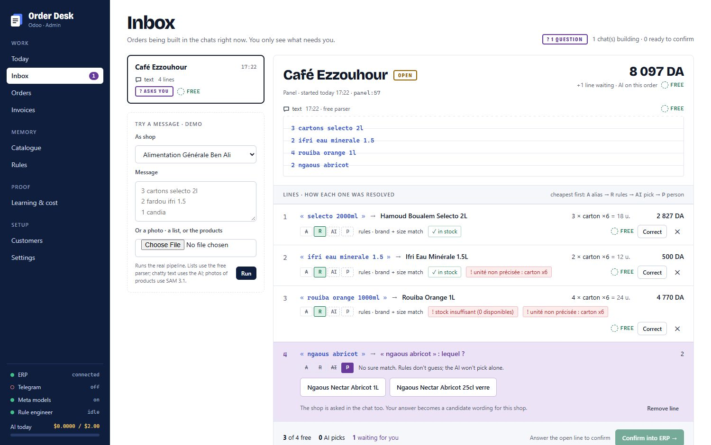
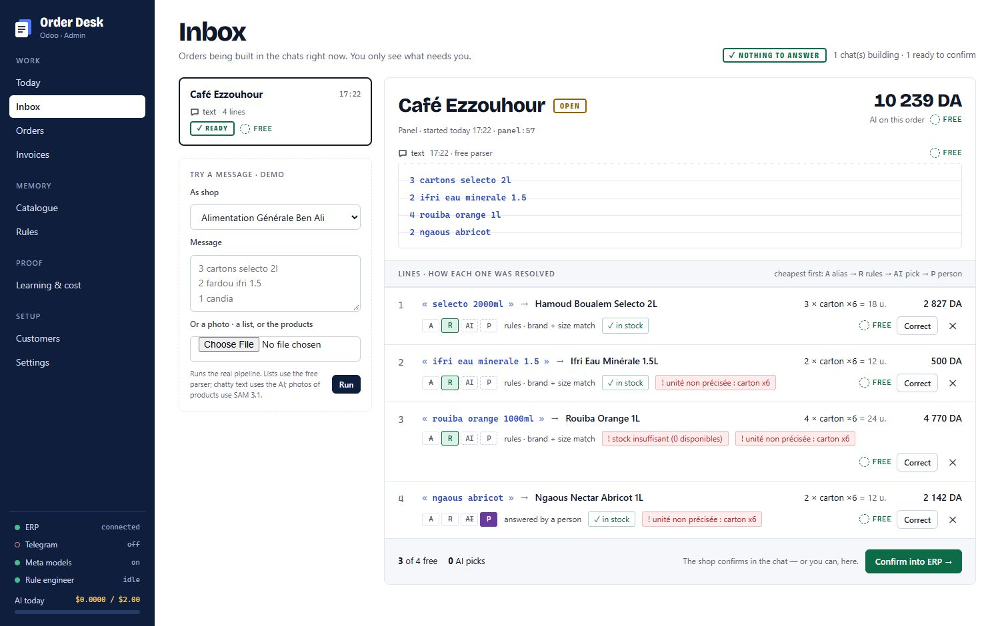
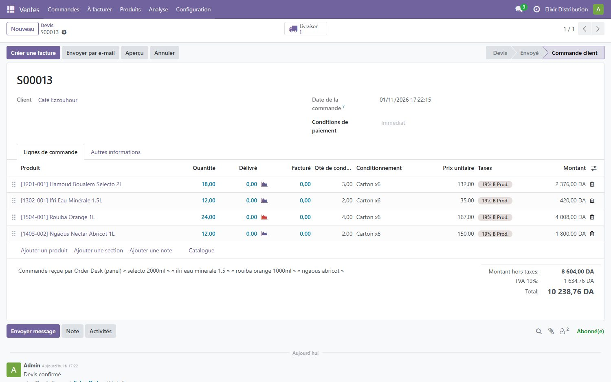
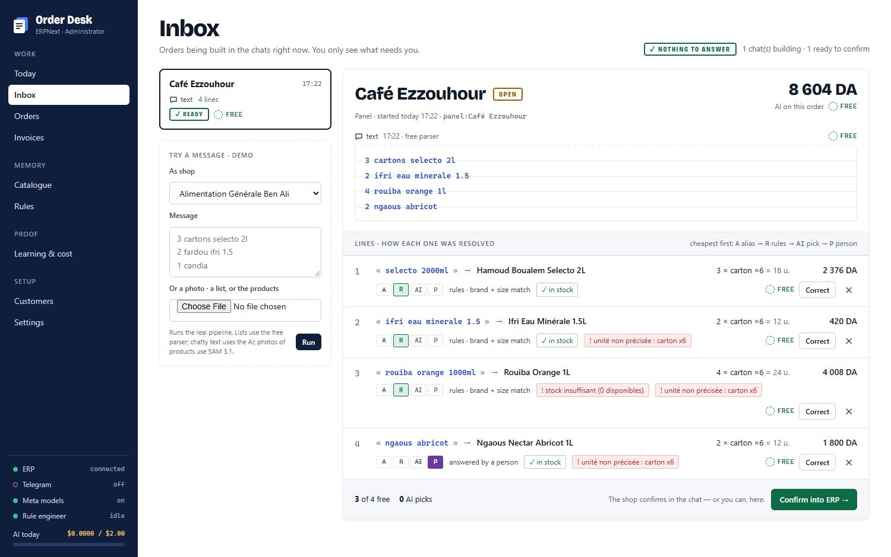
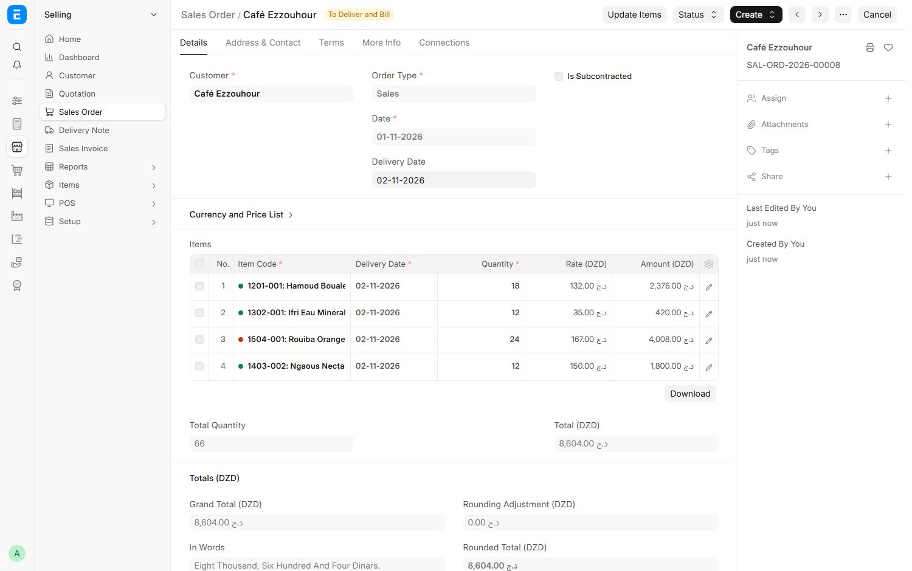
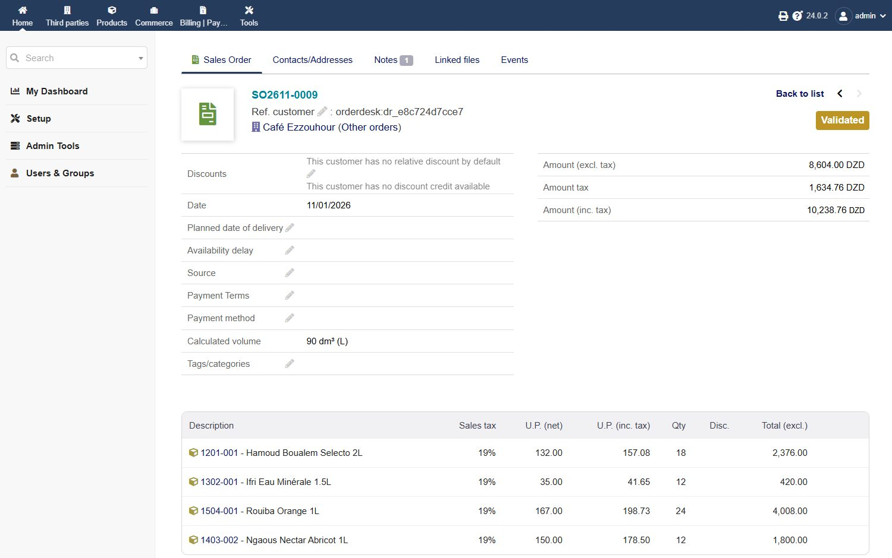
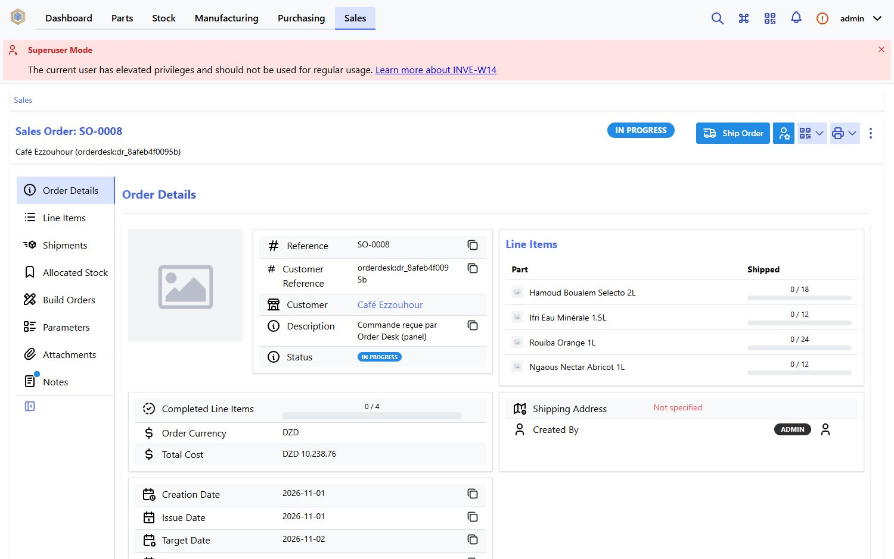
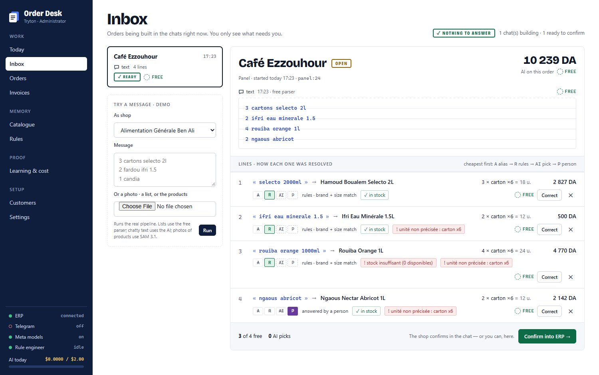
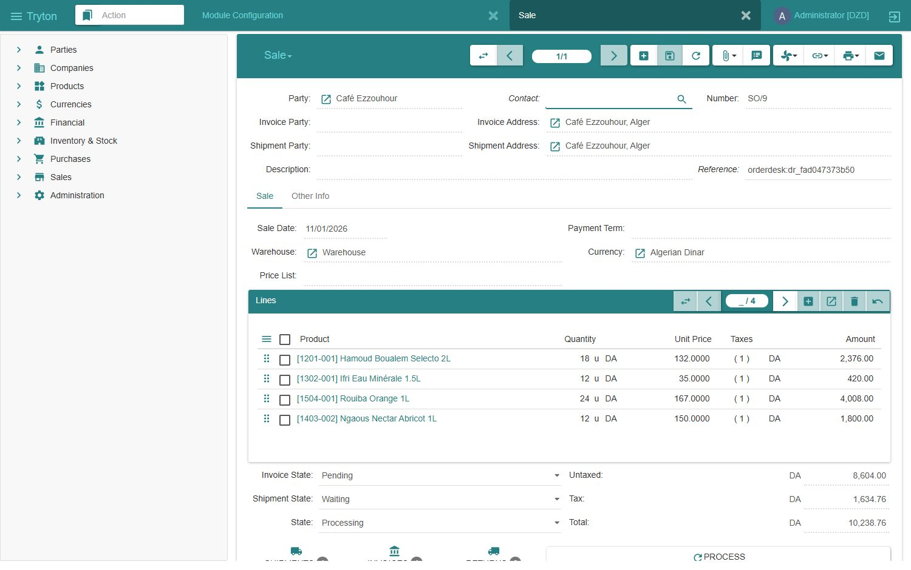

# Elixir Order Desk

**Orders from any chat into any ERP, on a catalogue that writes its own matching rules.**

Small shops order from their distributor the way they talk: voice notes in Darja, photos of handwritten
lists, "same as last time, plus two cartons of Ifri". Order Desk handles each message like this:

1. It turns every line into one precise product from the distributor's catalogue.
2. It checks the line against the ERP's own prices and stock.
3. It asks the shop only what it must.
4. It books a confirmed order in the ERP.

The same desk reads supplier invoices and books them as goods receipts. It works on Telegram, on WhatsApp
and from its own panel.

<p align="center"></p>

The matching is not an AI call on every line forever. Order Desk keeps two kinds of memory:

- **aliases**: every wording people use for every product;
- **rules**, written in a small rule language.

A background agent, the **rule engineer** (Muse Spark, with Muse Wonder as a fallback), studies the lines the
memory could not resolve. It writes a rule and tests it on every line whose answer is known. The **code** lets
the rule in only if it makes zero wrong matches. Week after week, more lines are resolved for free, and the AI
is called only for what is new.

Built during the Meta Global AI Developer Hackathon (October 26 – November 4, 2026). Everything in this
repository was written during the event.

## Contents

- [Order Desk in 60 seconds](#order-desk-in-60-seconds)
- [One order, five ERPs (screenshots)](#one-order-five-erps)
- [Run it: the full demo with Odoo](#run-it-the-full-demo-with-odoo)
- [The other ERPs](#the-other-erps)
- [Chat channels: Telegram and WhatsApp](#chat-channels-telegram-and-whatsapp)
- [Supplier invoices](#supplier-invoices)
- [How a line is resolved](#how-a-line-is-resolved)
- [Adaptive matching: a pipeline Muse Spark designs for each industry](#adaptive-matching-a-pipeline-muse-spark-designs-for-each-industry)
- [The rule language](#the-rule-language)
- [Meta models](#meta-models)
- [Configuration](#configuration)
- [Tests](#tests)
- [Security](#security)
- [Troubleshooting](#troubleshooting)
- [Repository layout](#repository-layout)

## Order Desk in 60 seconds

- **One program.** A single Go binary holds the panel, the JSON API, the Telegram and WhatsApp channels and
  the background workers, with SQLite for storage. It has no other service to run.
- **Any ERP.** It works with Odoo, ERPNext, Dolibarr, InvenTree and Tryton through each one's standard API,
  with nothing installed in the ERP. Each adapter passes the same live conformance test. Elixir Distribution,
  our existing ERP, is a sixth adapter. It is not part of the demo: everything here runs on the five
  open-source ERPs in `erps/`.
- **Any message.** It takes typed lists, chatty text, voice notes (Muse Voice Transcribe), photos of written
  lists, and photos of the products themselves (SAM 3.1 + Muse Spark).
- **Cheapest step first.** Each line climbs a ladder: codes, aliases, rules, a shortlist, one Muse Spark call
  per message, and a person. Most lines stop on a free step.
- **The model proposes, the code decides.** Muse Spark picks only from a shortlist the code built. Every rule
  and every change to the matching pipeline is measured on known answers before it goes live.
- **Every AI call is metered.** The panel shows the tokens and cost of each call. A daily budget stops the
  AI while aliases and rules keep working.

## One order, five ERPs

The same shop order goes through the same desk into each of the five ERPs:

```
3 cartons selecto 2l
2 ifri eau minerale 1.5
4 rouiba orange 1l
2 ngaous abricot
```

Three lines resolve for free (rules, brand and size). "ngaous abricot" matches two products and this shop has
no habit yet, so it is asked which one. After the answer the order is confirmed and opens in the ERP's own screens. The screenshots
were taken by `tools/capture_erps.py` against the Docker ERPs in `erps/`, with no manual step.

| ERP | In Order Desk | The order in the ERP |
|---|---|---|
| **Odoo 18** |  |  |
| **ERPNext v16** |  |  |
| **Dolibarr 24** |  |  |
| **InvenTree 1.6** |  |  |
| **Tryton 7.0** |  |  |

Click any image for full size. The question step for each ERP is in `docs/media/<erp>-1-question.jpg`.

## Run it: the full demo with Odoo

### What you need

| Tool | Version | Used for |
|---|---|---|
| [Go](https://go.dev/dl/) | 1.23 or newer | building Order Desk |
| [Docker](https://docs.docker.com/get-docker/) with Compose | any recent | the test ERPs |
| Python | 3.9 or newer, standard library only (no `pip install`) | the seed scripts and the simulators |
| [ffmpeg](https://ffmpeg.org/download.html) | any, on the PATH | voice notes only |
| A Meta Model API key | from https://dev.meta.ai | the AI steps (optional, see below) |

**Without a Meta key** the panel, the ERP connection, typed orders, questions and booking all work. Lines
that codes, aliases and rules cannot resolve are asked instead of being picked by Muse Spark. Voice notes,
photos, invoices and the rule engineer need the key.

Commands below are for a terminal opened in the repository folder. Where Windows differs, both forms are given.
On Windows, use `py` if `python` is not found.

### 1. Get the code

```bash
git clone https://github.com/nudiiir/elixir-orderdesk.git
cd elixir-orderdesk
```

### 2. Start Odoo and load the demo distributor

The demo distributor has 120 drinks and dairy products with packs, prices, VAT, barcodes and stock, plus 15
shops and 10 suppliers.

```bash
docker compose -f erps/odoo/docker-compose.yml up -d
```

Wait until http://127.0.0.1:8069 shows the Odoo page (about 30 seconds on the first start), then:

```bash
python erps/seed/odoo_setup.py
python erps/seed/odoo_seed.py erps/seed/seed.json
```

`odoo_setup.py` creates the database `orderdesk` with Sales, Purchase and Inventory, which takes 2–4 minutes.
The Odoo login is `admin` / `admin`.

### 3. Configure

macOS / Linux:

```bash
cp .env.example .env
```

Windows (PowerShell):

```powershell
Copy-Item .env.example .env
```

Open `.env` and set `META_MODEL_API_KEY`. Add `TELEGRAM_BOT_TOKEN` if you want the Telegram channel (see
[Telegram](#telegram)). Leave everything else empty for now. `.env` is git-ignored.

### 4. Build and start Order Desk

macOS / Linux:

```bash
go build -o orderdesk ./cmd/orderdesk
./orderdesk -addr 127.0.0.1:8610 -data ./data
```

Windows (PowerShell):

```powershell
go build -o orderdesk.exe ./cmd/orderdesk
.\orderdesk.exe -addr 127.0.0.1:8610 -data .\data
```

Expected output:

```
2026/11/01 17:00:00 Order Desk panel on http://127.0.0.1:8610 (Meta: true, ERP: false)
```

### 5. Connect the ERP

Open http://127.0.0.1:8610 → **Settings** → **ERP connection** and fill in:

| Field | Value |
|---|---|
| ERP | Odoo |
| Address | `http://127.0.0.1:8069` |
| Database | `orderdesk` |
| User | `admin` |
| API key or password (kept) | `admin` |

Click **Connect**. The catalogue syncs right away: the side bar shows *ERP connected*, and **Catalogue** lists
120 products. Odoo's API needs a secret on every call, so Order Desk keeps the one you give it. With a real
Odoo, give it an API key (Odoo → your profile → Account Security → New API key), which you can revoke.

### 6. Send an order

Go to **Inbox** → **Try a message**, choose a shop, paste the order below and click **Run**:

```
3 cartons selecto 2l
2 ifri eau minerale 1.5
4 rouiba orange 1l
2 ngaous abricot
```

What happens:

- Each line shows how it was resolved: A alias, R rules, AI pick or P person, with its cost.
- "ngaous abricot" waits for an answer. Click **Ngaous Nectar Abricot 1L**.
- Click **Confirm into ERP →**. The toast shows the Odoo order number, for example `Order S00013 created in the ERP`.
- Open http://127.0.0.1:8069 → Sales: the order is there, with the shop's words in the notes.

Send the same order again: the line you answered is now resolved by an alias, for free. Try chatty text too
("salam, mets moi 2 fardeaux ifri et 3 selecto"), or a photo of bottles with **Choose File**.

### 7. Watch it learn

- **Learning & cost** shows lines resolved for free vs by the AI, and every AI call with its tokens and cost.
- **Rules** lists the rules the rule engineer proposed, the gate's verdict on each, and its birth timeline:
  proposed → benchmark → shadow → live. **Rules → Run engineer now** starts a session at once. It also runs by itself
  once 50 lines have needed the AI or a person since its last run.
- **Catalogue** → a product shows every wording learned for it and how many confirmations each one has.

## The other ERPs

Each ERP is started and seeded the same way. Full instructions, including the live adapter tests and how to
write an adapter for another ERP, are in [docs/ERPS.md](docs/ERPS.md).

| ERP | Start | Seed | Settings → ERP connection |
|---|---|---|---|
| Odoo 18 | `docker compose -f erps/odoo/docker-compose.yml up -d` | `python erps/seed/odoo_setup.py`, then `python erps/seed/odoo_seed.py erps/seed/seed.json` | `http://127.0.0.1:8069`, database `orderdesk`, `admin` / `admin` |
| ERPNext v16 | `docker compose -p od-erpnext -f erps/erpnext/pwd.yml up -d` (4 GB RAM; first start 3–5 min) | `python erps/seed/erpnext_setup.py erps/seed/seed.json` | `http://127.0.0.1:8090`, `Administrator` / `admin` |
| Dolibarr 24 | `docker compose -f erps/dolibarr/docker-compose.yml up -d` | `python erps/seed/dolibarr_setup.py erps/seed/seed.json` | `http://127.0.0.1:8081`, `admin` / `admin` |
| InvenTree 1.6 | `docker compose -f erps/inventree/docker-compose.yml up -d` | `python erps/seed/inventree_setup.py erps/seed/seed.json` | `http://127.0.0.1:8083`, `admin` / `admin` |
| Tryton 7.0 | `docker compose -f erps/tryton/docker-compose.yml up -d db`, then `… run --rm init`, then `… up -d tryton` | `python erps/seed/tryton_setup.py erps/seed/seed.json` | `http://127.0.0.1:8000`, database `orderdesk`, `admin` / `admin` |

All test instances listen on 127.0.0.1 only, and their logins are throwaway test logins. To switch ERP,
connect another one in Settings: the catalogue is synced again from it.

## Chat channels: Telegram and WhatsApp

Shops and the owner are linked to the desk with a **pairing code** from the panel. A shop's code comes from
**Customers → Pairing code**. The owner's code, used to send supplier invoices, comes from **Invoices →
Pairing code**. Sending the code in a chat links that chat; `/deconnecter` unlinks it.

### Telegram

Telegram uses long polling, so it needs no public address.

1. In Telegram, open [@BotFather](https://t.me/BotFather) → `/newbot` → choose a name and a username. Copy the
   token it gives you.
2. Put it in `.env` as `TELEGRAM_BOT_TOKEN=…` and restart Order Desk. The log shows the bot's name.
3. **Customers** → pick a shop → **Pairing code** → send the code to your bot.
4. Order the way a shop does: `3 selecto 2l, 2 cartons ifri, 1 candia`, a voice note, or a photo. Questions
   come back as buttons. **✅ Confirmer** books the order in the ERP.

### WhatsApp

WhatsApp works through Meta's Cloud API or through Twilio, and both need a public HTTPS address (a tunnel).
To try it **without any WhatsApp account**, `tools/whatsapp-sim` plays both Meta and a phone, locally. The
three setups, from the quickest to the real thing, are in [docs/WHATSAPP.md](docs/WHATSAPP.md).

## Supplier invoices

The owner sends a photo or PDF of a supplier invoice, in the owner's chat or on the **Invoices** screen (*Drop a photo or PDF*). Here is
what happens:

1. Muse Spark reads the supplier, the number, the date and every line with its quantity, price and total.
2. Each line is resolved in that supplier's scope, with its own wordings and rules.
3. The quantities are checked against the line totals (packs vs units).
4. Once approved, the invoice is booked in the ERP as a goods receipt that moves the stock.

Try it with [samples/invoice-specimen.png](samples/invoice-specimen.png). It is a fictional invoice from the
demo wholesaler, marked as a specimen; `python tools/make_invoice.py out.png` draws it again.

## How a line is resolved

| Step | What happens | Cost |
|---|---|---|
| −1 · codes | a printed barcode or reference, or a supplier's article code confirmed before | free |
| 0 · normalise | lower case, accents, Arabic digits, sizes (`1,5 L` → `1500ml`), the desk's Matching Profile, live rewrite rules | free |
| 1 · alias | a trusted wording for this shop or supplier | free |
| 2 · rules | synonyms, packs, defaults, guards, attributes, then an exact catalogue match | free |
| 3 · shortlist | the 8 most likely products the code would accept (same attributes, the brand the line names) | free |
| 4 · Muse Spark | picks one id **from the shortlist only**, one call for all the open lines of a message | paid |
| 5 · person | one precise question with buttons | — |

Messages are cut into items first. Plain lists use a deterministic parser, with no AI. For voice notes, Muse
Voice Transcribe writes the text, then Muse Spark extracts the items. It quotes the shop's words and never
chooses products, and it gets only the brand names in its prompt, never the catalogue. "Same as last time"
is copied from the ERP by code.

**Photos.** Muse Spark first tells a written list, which it copies line by line, from a photo of the products
themselves. For products:

1. **SAM 3.1** finds every bottle, can or carton, with one call per kind of packaging.
2. Duplicate and weak boxes are dropped.
3. Muse Spark reads all the crops in one call, the way a shop would type them ("Selecto 2L").
4. Identical products are counted, and a caption like "3 cartons" applies to a single product.

The shop gets its photo back with every product boxed in a colour that matches the reply ("🟩 2 × Selecto 2L").
A photo costs about $0.015.

**Learning.** Every confirmed line becomes ground truth and a witness for its wording. A wording becomes a
trusted alias after two confirmations, and a supplier's article code after one. A person's correction blocks
the wrong wording, retires a code that named two products, and counts against the rule that gave the wrong
answer. A rule goes back after repeated corrections.

## Adaptive matching: a pipeline Muse Spark designs for each industry

Every industry writes its products in its own way: strengths and forms, dimensions and inch sizes, flavours
and pack counts. Order Desk does not ship that knowledge. It learns it per desk (`internal/profile`):

- **Bootstrap.** Muse Spark reads a sample of the catalogue and designs a first Matching Profile:
  - which first-pass blocks this industry needs (`strength`, `dimensions`, `inch`, `units_glue`, `pack_count`,
    `shade`, `split_glued`);
  - the vocabulary its suppliers use;
  - the attributes that tell products apart;
  - a search method.
- **Proof.** The code measures every proposal in a scratch lab, on confirmed lines and on lines Spark never
  saw. A proposal is kept only with zero wrong, zero lost and no products made to read alike. Vocabulary
  proposed before any evidence waits in shadow. A word that would drop or change digits is refused, because
  codes go to the code table.
- **Search.** BM25, character trigrams and word similarity are raced on real lines (`internal/search`). The
  winner is kept only if it holds on unseen lines.
- **Codes.** A printed barcode or manufacturer reference resolves a line at once. A supplier's article code is
  learned from one confirmation and retired if it ever names two products. Until a second confirmation, Spark
  still checks it.
- **Earned autonomy.** Muse Spark checks every answer the code gives until the code's precision clears a 99 %
  lower bound (about 270 confirmed answers). After that it spot-checks risky answers, and a correction sends
  that supplier back under supervision (`internal/desk/autonomy.go`).

### Results on replayed invoices

`cmd/adaptive` replays an invoice set through this loop:

1. Muse Spark designs the profile.
2. It checks every line of the training invoices, and a clerk who knows the answers confirms or corrects them.
3. The profile is calibrated twice.
4. The trained desk is measured on invoices it never saw, with nothing answered or learned.

| Industry | Catalogue | Unseen test invoices | Resolved free | Muse Spark pick | Asked | **Wrong, booked automatically** | AI cost of the test |
|---|---|---|---|---|---|---|---|
| Hardware & electrical (synthetic, shipped in `samples/`) | 612 products | 18 invoices, 186 lines | 72 % | 17 % | 12 % | **0** | $0.11 |
| Supermarket / FMCG (a real store's catalogue, not shipped) | 1,160 products | 20 invoices, 234 lines | 87 % | 4 % | 9 % | **0** | $0.05 |

While Spark checked every answer in training, it agreed with the code on every line the code resolved: 202 of
202 in hardware, 272 of 272 in FMCG. The profile Spark designed for hardware turned on `split_glued`, `inch`
(`15/21` → ½"), `dimensions` (`M8X20`) and `pack_count`. It learned supplier shorthands like `zn` → *zinguée*
and `th` → *tête hexagonale* as gated rules, and made colour and finish attributes that keep *blanc* and
*noir* paint apart.

Run it yourself on the hardware set. It costs about $1.50 of Meta Model API credits:

```bash
go build -o adaptive ./cmd/adaptive                 # Windows: adaptive.exe
./adaptive -in samples/replay-hardware.json -out ./run-hardware -keys .env
go build -o readas ./cmd/readas
./readas -data ./run-hardware/desk "VIS TH M8X20 ZN BT100" "ROBINET 15/21"
```

`run-hardware/report.md` lists what Spark identified, every experiment with the gate's verdict, and the phase
table above. `readas` prints how the trained desk reads a line.

## The rule language

Eight rule types, each shown in the panel as a sentence generated from its structured form:

| Type | Example sentence |
|---|---|
| **synonym** | `"slkt"` means `"selecto"` |
| **rewrite** | `"1l5"` is written as `"1.5l"` |
| **pack** | a trailing `"x{n}"` means a carton of `{n}` |
| **default** | for Épicerie Nour, `"ifri"` with no size means Ifri 1.5 L |
| **guard** | `"citron"` only matches products whose name contains "citron" |
| **attribute** | `"zero"`, `"light"` each name a variant, in orders, invoices and catalogue names alike |
| **word** | `"pet"` describes a product but never tells two products apart |
| **policy** | Two texts whose colour differs are never the same product. |

Patterns use literal words, `a|b`, `{n}`, `{size}`, `{word}`, `^` and `$`. Scopes are global, tenant, supplier
or customer.

A rule's life is proposed → benchmark → **gate** → shadow → live:

- **benchmark**: the rule runs on every ground-truth line, through the free steps only;
- **gate**: the rule needs 0 wrong, 0 conflicts and a minimum gain;
- **shadow**: the rule watches live lines;
- **live**: after N agreements.

A live rule is rolled back automatically after repeated corrections by people. Every step is an event, shown
as the rule's birth timeline in the panel.

## Meta models

Every model Order Desk calls at runtime is a Meta model, through the Meta Model API.

| Model | Used for |
|---|---|
| **Muse Spark 1.3** (`muse-spark-1.3`) | telling list photos from product photos; copying lists; reading each product SAM found; reading supplier invoices; extracting items from conversations; picking from a shortlist; designing and calibrating the Matching Profile; and the rule engineer, a tool-using agent (`list_residue`, `search_catalogue`, `list_rules`, `run_benchmark`, `submit_rule`) |
| **Muse Wonder 1.0** (`muse-wonder-1.0`) | the rule engineer's fallback when a Muse Spark session finds no rule the gate admits |
| **Muse Voice Transcribe** (`muse-voice-transcribe-1.0`) | Darja, French and Arabic voice notes to text |
| **SAM 3.1** (`sam-3.1`) | finding every product on a photo of the products (boxes from its segmentation output) |

Every call is logged with its tokens and cost (**Learning & cost**). A daily budget (**Settings**, $2 by
default) stops AI calls while aliases and rules keep working.

## Configuration

### Command line

```
orderdesk [-addr 127.0.0.1:8610] [-data ./data] [-keys .env,whatsapp.env] [-no-telegram]
```

| Flag | Default | Meaning |
|---|---|---|
| `-addr` | `127.0.0.1:8610` | panel, API and webhook address |
| `-data` | `data` | data folder: the SQLite database, voice notes, photos, invoices |
| `-keys` | `.env` if present | keys files with `KEY=value` lines, comma-separated (never printed) |
| `-no-telegram` | off | do not start the Telegram connector even if a token is set |

### Environment (`.env`)

| Variable | Needed for |
|---|---|
| `META_MODEL_API_KEY` | every AI step |
| `TELEGRAM_BOT_TOKEN` | the Telegram channel |
| `WHATSAPP_TOKEN`, `WHATSAPP_PHONE_ID`, `WHATSAPP_VERIFY_TOKEN`, `WHATSAPP_APP_SECRET` | WhatsApp through Meta's Cloud API ([docs/WHATSAPP.md](docs/WHATSAPP.md)) |
| `TWILIO_ACCOUNT_SID`, `TWILIO_AUTH_TOKEN`, `TWILIO_WHATSAPP_FROM`, `TWILIO_WEBHOOK_URL` | WhatsApp through Twilio |
| `FFMPEG` | the path to ffmpeg, if it is not on the PATH |

The ERP connection is made in the panel, not in `.env`. The other variables in `.env.example` are only for
the live tests.

### Panel settings

**Settings** holds the learning thresholds:

- confirmations before an alias is trusted;
- shadow agreements before a rule goes live;
- corrections before a rule is rolled back;
- the gate's minimum gain.

It also holds the rule engineer's models and schedule, the daily AI budget, and whether approved invoices are
posted at once.

## Tests

```bash
go vet ./...
go test ./...
```

The offline tests need nothing. They cover:

- normalisation and the Matching Profile blocks;
- the rule language and the gate;
- codes and the autonomy bound;
- the WhatsApp and Twilio channels;
- the resolver's benchmarks.

The live tests run only when their variables are set, and are skipped otherwise:

- the adapter conformance test against each Docker ERP ([docs/ERPS.md](docs/ERPS.md#live-adapter-tests));
- the photo test (`ORDERDESK_PHOTO`, `META_MODEL_API_KEY`).

## Security

- **The panel answers this computer only.** It has no login, so it refuses any request that does not come
  from 127.0.0.1. That covers forwarding headers from a tunnel, another host name (DNS rebinding), and a write
  sent by another site's page (CSRF). It also sets `X-Frame-Options: DENY`.
- **The webhook is the only public route.** A tunnel reaches `/whatsapp/webhook` only. Every call must carry
  Meta's or Twilio's signature, and Order Desk refuses to start the Cloud API channel without
  `WHATSAPP_APP_SECRET`.
- **Inputs are bounded.**
  - Request bodies, downloads (25 MB) and photos (40 megapixels, checked before decoding) have size limits.
  - Media paths are sanitised.
  - ffmpeg only reads its pipe.
- **Secrets stay out of logs.** Keys are read from `.env` or keys files and never printed. The Telegram token
  is stripped from network errors.
- **ERP passwords are not kept.** For ERPNext, Dolibarr, InvenTree and Tryton the password is used once to
  obtain a revocable key. For Odoo, give an API key.
- **Nothing secret is in the repository.** The demo data uses placeholder phone numbers, and `.env`,
  databases and data folders are git-ignored.

## Troubleshooting

| Symptom | Fix |
|---|---|
| `odoo_setup.py` fails with a connection error | Odoo is still starting: wait until http://127.0.0.1:8069 answers, then run it again |
| ERPNext seed fails right after `up -d` | the site is still being created: wait for `create-site` to exit (`docker compose -p od-erpnext -f erps/erpnext/pwd.yml logs -f create-site`) |
| Tryton connect says the database does not exist | run the `init` step once (`docker compose -f erps/tryton/docker-compose.yml run --rm init`) |
| The panel shows `the Order Desk panel only answers on this computer` | open it as `http://127.0.0.1:8610` or `http://localhost:8610`, not through a tunnel or a LAN address |
| `Meta: false` in the start line | `META_MODEL_API_KEY` is not set: check `.env`, or pass `-keys path/to/file` |
| Voice notes fail | install ffmpeg, or set `FFMPEG` to its path |
| WhatsApp channel refuses to start | set `WHATSAPP_APP_SECRET` (Meta app → Settings → Basic) |
| Port 8610 is taken | start with another address: `-addr 127.0.0.1:8620` |

## Repository layout

```
cmd/orderdesk/        the program: panel + JSON API + Telegram + WhatsApp + workers
cmd/adaptive/         replays invoices through the adaptive pipeline and writes what Spark identified
cmd/replay/           replays invoices through the classic pipeline (before / learning / after)
cmd/readas/           prints how a trained desk reads a line
internal/catalog/     products mirror, packs, aliases, codes, normalisation, shortlist
internal/profile/     the Matching Profile: first-pass blocks, lexicon, the lab, Spark's design and calibration
internal/search/      BM25, trigram and word-similarity search, raced per desk
internal/rules/       the rule language: types, patterns, interpreter, sentences
internal/resolve/     the resolution ladder, the Muse Spark pick, the sentinel
internal/engineer/    the rule engineer (Muse Spark + tools), benchmark, gate
internal/desk/        the order agent: extraction, photos, drafts, questions, confirmation, learning,
                      supplier invoices, earned autonomy
internal/adapter/     the ERP contract and one adapter per ERP (odoo, erpnext, dolibarr, inventree,
                      tryton, elixir); adaptertest/ is the live conformance test every adapter passes
internal/meta/        Meta Model API client with a cost meter and a daily budget
internal/telegram/    Telegram Bot API (long polling: no public address needed)
internal/whatsapp/    WhatsApp Cloud API webhook; internal/twilio/ the same through Twilio
internal/web/         panel and JSON API
erps/                 Docker setups and seed scripts for the five open-source ERPs
samples/              a specimen supplier invoice and the hardware replay set
tools/                WhatsApp simulator, invoice generator, ERP screenshot capture
docs/                 ERPs, WhatsApp, screenshots
```

## License

[Apache-2.0](LICENSE)
