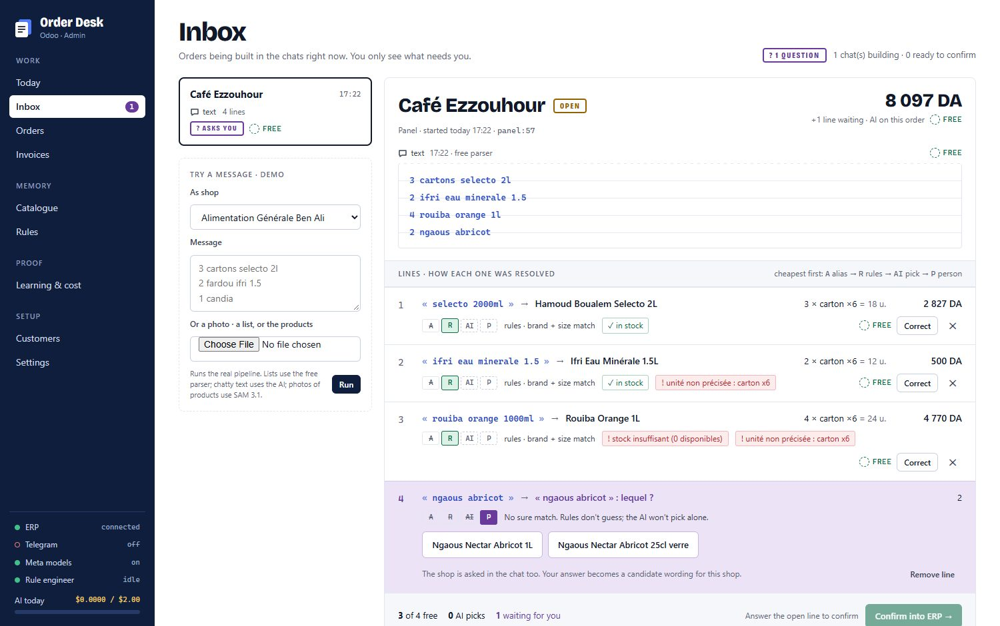
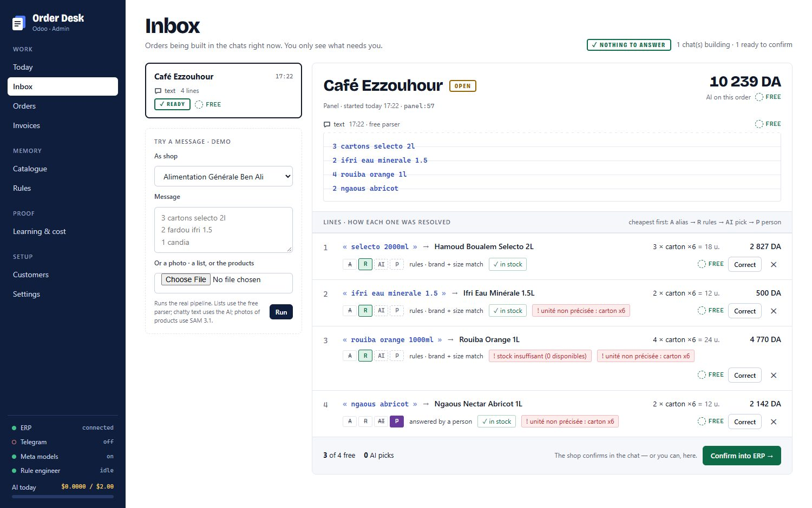
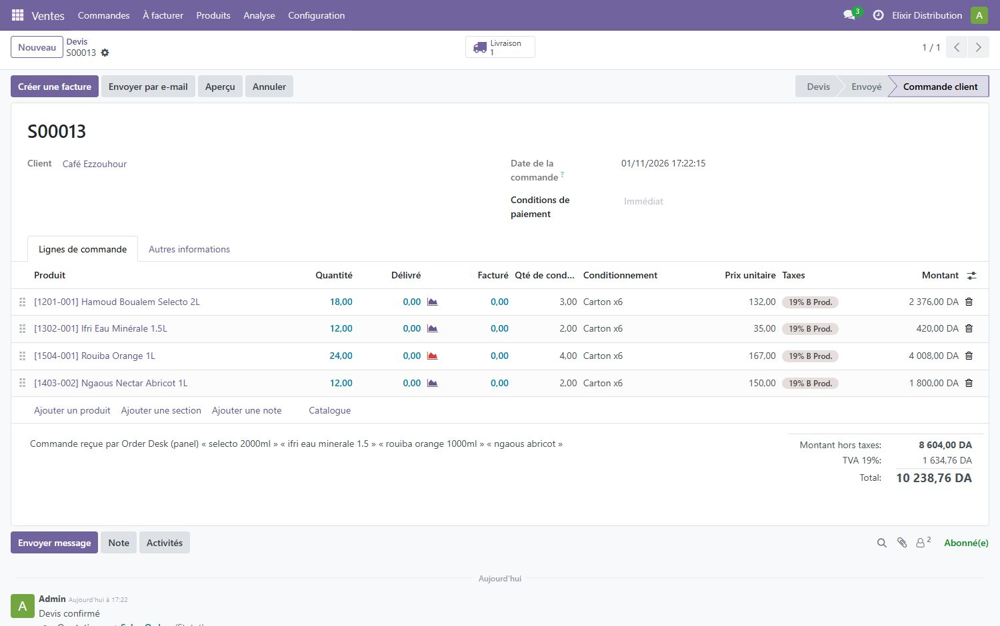
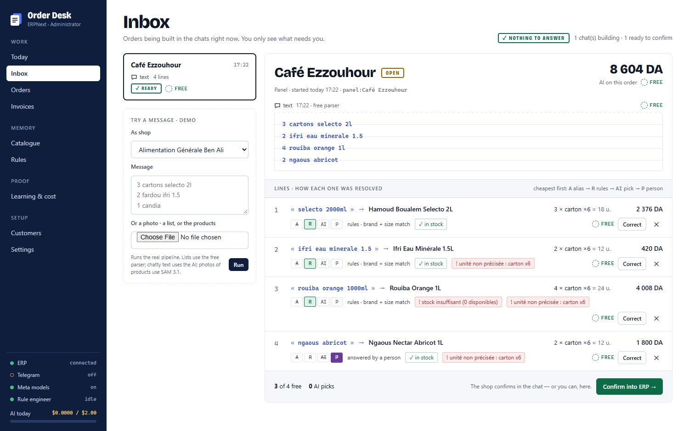
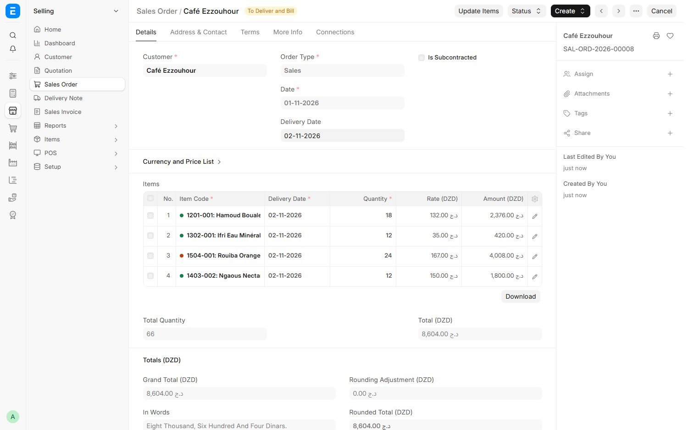
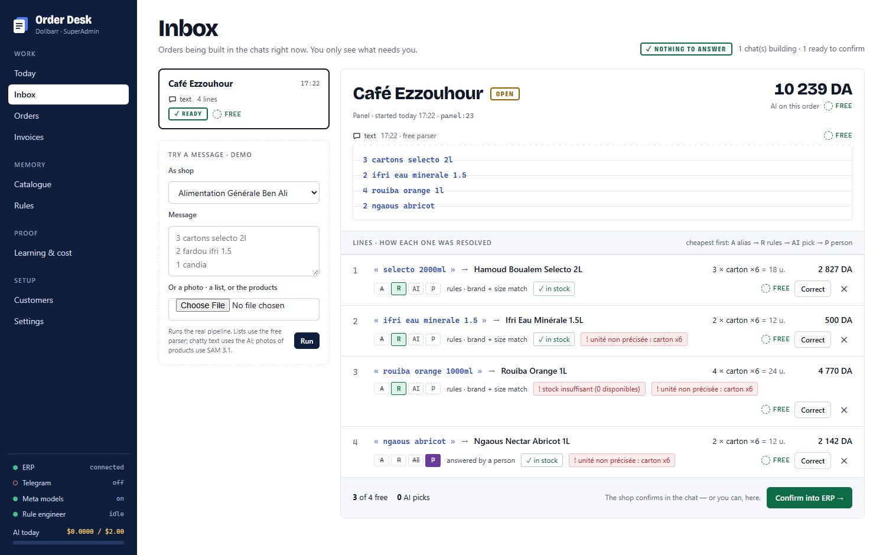
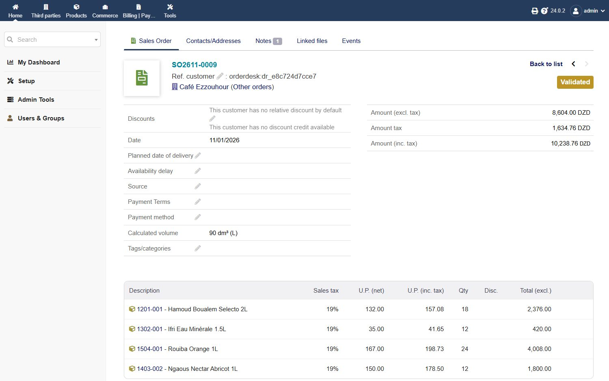

# Elixir Order Desk

**Shops order on WhatsApp the way they talk: Darja voice notes, photos, French and Arabic mixed. Order Desk
books every line into the distributor's ERP, asks when it is not sure, and Muse Spark teaches it to do the
job without a model call.**

*Meta Global AI Developer Hackathon · **Startups track** · by [Elixir](https://gestion.elixir-dz.com), makers
of the Elixir Distribution ERP ([before and during the hackathon](#startups-track-what-existed-before-and-what-we-built)).*

**Try it now:**

- **[Telegram bot](https://t.me/elixirOrderDeskbot)** (access code in the submission form): a demo shop on a real supermarket
  catalogue, booking into Odoo. Send an order in Darja or French, a voice note or a photo of the list.
  In the recorded run, typed orders were answered within 3 s, a voice note in 83 s and an invoice photo in
  36 s (`docs/demo/data.json`).
- **[Panel, read-only](https://orderdesk-demo.elixir-dz.com)**: the same desk, every line's resolution and
  every Meta model call with its cost.
- **[Odoo](https://odoo-demo.elixir-dz.com)** (read-only login in the submission form): the orders it booked.
- **[Live replay](https://nudiiir.github.io/elixir-orderdesk/demo/)**: a recorded run of the real pipeline,
  a typed order, a Darja voice note, a supplier invoice and the next order settled for free.
- **On your machine, no key, no Docker, no ERP:**

  ```bash
  go run ./cmd/orderdesk -demo
  ```

  Open http://127.0.0.1:8610 → **Inbox** → **Try a message**. It starts the trained supermarket desk from the
  benchmark with a demo ERP that writes booked orders to `data-demo/demo-orders.jsonl`, and 3 demo shops.
  Keyless, the parser, the learned wordings and the rules answer and anything else becomes a question; set
  `META_MODEL_API_KEY` and Muse Spark joins in.

**Three numbers, all from [`bench/`](bench/)** (`python bench/check.py` recomputes them in a second, no key):

| | |
|---|---|
| **93 %** of supplier-invoice lines booked automatically, **3 wrong in 2,169** | 120 locked invoices in 4 industries the desk never learned from |
| **76 %** of shop-order lines booked right, **3 wrong products in 1,272** (and 7 right products with a wrong quantity), the rest asked | 200 orders: French, Darja in Latin letters, Darja with Arabic-script quantities and units, screenshots, voice notes |
| **4–8× cheaper** per invoice than Muse Spark alone, with the same 3 wrong | the same locked lines, Spark given the whole catalogue |

**Why it matters.** At a distributor, a clerk retypes every WhatsApp order and every supplier invoice into
the ERP, guessing which of 1,000 products "ifri 1.5" means. Per 100 supplier invoices, Order Desk books
**1,682 of 1,808 lines** with nobody typing; per 100 shop orders, **484 of 636**. At 20 seconds a line (our
assumption, not a measurement) that is **9.3 and 2.7 clerk hours**. And a line it is not sure of becomes a
question, not a wrong delivery: 3 wrong products in 1,272 lines (plus 7 wrong quantities), every other doubt asked.

<p align="center"></p>

## Why WhatsApp

Wholesale in Algeria runs on WhatsApp. Open any wholesale group or distributor page on Facebook and the same
line keeps coming back: *"orders on WhatsApp."* No portal, no app, no order form. Just a chat, full of voice
notes, photos and abbreviations. **Order Desk is built for that chat, not against it.**

## Why we built it

We already serve the shops. [Elixir](https://elixir-dz.com), our app for pharmacies in Algeria, has
**1,265 pharmacies signed up, 120 used it in the last 30 days and 72 on an active subscription** (our
figures, November 2026). Every one of them orders from distributors, on WhatsApp.

Order Desk is how we reach those distributors. One of them told us what this project solves: his clerks
retype every order and every supplier invoice by hand. A second distributor has agreed to test Order Desk.
We start with pharmacy and cosmetics distributors, then any wholesaler whose shops order on WhatsApp, on
whatever ERP they run, including our own [Elixir Distribution](https://gestion.elixir-dz.com).

## How it works

1. **Muse Voice Transcribe** hears the voice note, primed with the distributor's own brand names.
2. **SAM 3.1** finds each product on a photo and **Muse Spark** reads it; Muse Spark also copies written
   lists and cuts chatty text into items. Without a key, a lenient parser takes over and asks.
3. Every line climbs a ladder, cheapest first: codes, trusted wordings, rules, a shortlist, one Muse Spark
   pick from that shortlist, and a person. It is checked against the ERP's prices and stock.
4. The confirmed order is booked in the ERP (Odoo, ERPNext, Dolibarr, InvenTree or Tryton) through its
   standard API, with nothing installed in it. Confirming twice never books twice.

The same desk reads supplier invoices (Muse Spark and **Muse Wonder** read each one independently, and a
line they disagree on goes to a person) and books them as goods receipts. It runs on WhatsApp (Meta's Cloud
API), Telegram and its own panel.

**Muse Spark builds the free path.** It designs each industry's matching from the catalogue (how sizes,
strengths and pack counts are written, the vocabulary, the search method), picks products for new wordings,
writes rules in a small rule language, and a second Spark call, the breaker, attacks each rule with
look-alike lines. The code admits a rule only with zero wrong matches, and Spark checks every free answer
until the code's precision clears a 99 % lower bound. Learning trusts only what a person chose or corrected,
and trusted wordings and rules. Details: [docs/HOW-IT-WORKS.md](docs/HOW-IT-WORKS.md).

## One order, five ERPs

The same shop order goes through the same desk into five open-source ERPs, with nothing installed in them.
Three lines resolve for free, one is asked, and the confirmed order opens in the ERP's own screens. The
screenshots were taken by `tools/capture_erps.py` against the Docker ERPs in `erps/`, with no manual step.

| ERP | In Order Desk | The order in the ERP |
|---|---|---|
| **Odoo 18** |  |  |
| **ERPNext v16** |  |  |
| **Dolibarr 24** |  |  |

**InvenTree 1.6** and **Tryton 7.0** too: all five, with the question step for each, in
[docs/RUN.md](docs/RUN.md#one-order-five-erps).

## Benchmark

Four real catalogues (electronics 796 products, pharmacy 524, cosmetics & parapharmacy 586, supermarket 587),
150 supplier invoices each: the desk learns from 120 the way a clerk trains it, and is scored on 30 locked
invoices it never learns from.

| 30 locked invoices per industry, after 120 learned | Automatic (before → after) | Free, no model call | Asked | **Wrong** | Meta cost / invoice | Muse Spark alone |
|---|---|---|---|---|---|---|
| Electronics, 535 lines | 89 % → **96 %** | 68 % | 4 % | **0** | **$0.0031** | 96 %, 1 wrong, $0.024 |
| Cosmetics, 533 lines | 85 % → **94 %** | 52 % | 6 % | **0** | **$0.0042** | 88 %, 0 wrong, $0.021 |
| Supermarket, 554 lines | 80 % → **92 %** | 65 % | 8 % | **3** | **$0.0045** | 85 %, 2 wrong, $0.020 |
| Pharmacy, 547 lines | 90 % → **92 %** | 45 % | 8 % | **0** | **$0.0043** | 98 %, 0 wrong, $0.020 |
| **All, 2,169 lines** | **93 %** | **58 %** | | **3** | **$0.0040** | 92 %, 3 wrong, $0.021 |

- **Against Muse Spark alone** (the whole catalogue in every prompt): 93 % vs 92 % automatic overall, 3 wrong
  each, 4–8× cheaper. The desk is ahead in cosmetics and the supermarket, ties in electronics, and Spark alone
  is ahead in pharmacy (98 vs 92).
- **Learning pays overall, not every round.** Every industry ends freer and cheaper than it started, with
  dips on the way: pharmacy 90 % → 88 % after round 30, the supermarket's cost up at round 60, cosmetics 2
  wrong at rounds 60 and 90.
- **The desk learns each distributor's wordings, and that is the product.** 79 % of the locked lines repeat
  a (supplier, wording) pair seen in training, as real suppliers print a product the same way every time.
- **First-seen wordings are Spark's job.** On the cold-start set (160 printed invoices, only 2 % of locked
  lines seen before), Spark alone books 91 % of 813 lines and the desk 84 %, asking the rest at a quarter of
  the cost. **The safety record holds either way: 3 wrong in 813 lines there, 3 in 2,169 here.**
- **Where the free answers come from**, over all test rounds: 18 % a wording Spark picked or a rule it wrote,
  77 % a match through the matching Spark designed (52 % plain catalogue matches, which the credit gives
  Spark), 5 % taught by a person. In pharmacy, the rules Spark wrote while designing the Matching Profile
  answered 32 % of the free lines.

**200 shop orders**, 50 per industry, through the same trained desks with nothing learned from the orders:

| 200 orders, 1,272 lines | Booked right | Right quantity and unit | Asked | **Wrong** | Missed by the reader | Meta cost / order |
|---|---|---|---|---|---|---|
| Typed: French · Darja (Latin) · mixed Arabic | 84 % · 84 % · 85 % | 100 % | 15–16 % | **1** | 0 % | $0.009 |
| Screenshots | 79 % | 100 % | 21 % | **1** | 0 % | $0.008 |
| Voice notes | 46 % | 94 % | 39 % | **1** | 15 % | $0.017 |
| **All** | **76 %** | **99 %** | 21 % | **3** | 3 % | **$0.010** |

Voice is the hard part: of the 40 voice notes, 8 are human recordings and 32 text-to-speech, and on the human
ones the reader missed 28 % of the products. The desk asks rather than guess.

**What is synthetic, said plainly:** the invoices and orders are generated from real catalogues and real
wordings; the printed set is replayed from the text printed on it (it measures matching, not reading); the
invoice "photos" in `samples/readbench` are computer renders. Per-industry curves, the credit table, the
cold-start comparison, the earlier hardware runs, the breaker and the eight bugs the benchmark found:
**[docs/BENCHMARK.md](docs/BENCHMARK.md)**.

## Labour, and who else does this

| Per 100 | Lines | Booked right with nobody typing | Clerk time saved at 20 s a line (assumption) |
|---|---|---|---|
| Supplier invoices | 1,808 | **1,682** | **9.3 hours** |
| Shop orders | 636 | **484** (the rest asked to the shop as buttons, or missed) | **2.7 hours** |

| Who | What they do well | What Order Desk adds |
|---|---|---|
| Choco AI | order intake for food distributors from email, voicemail and text | Darja voice notes and Arabic-script orders; any of five ERPs with nothing installed in them |
| Conexiom, Esker | purchase orders from business buyers (email, PDF, EDI) into the ERP | the chat a corner shop really uses: WhatsApp voice, photos, chatty Darja mixed with French |
| Nanonets, Rossum, Mindee | reading invoices and documents into fields | goes on to the exact catalogue product, checks price and stock and books it; two Meta readers must agree |
| WATI, Interakt | selling on WhatsApp: catalogues, broadcasts, bots | the shop writes its order freely, no menu to scroll |
| ERP vendors' own portals | the shop orders inside the ERP | the shop never logs in anywhere; the ERP still gets the order |

Across all of them, Order Desk's edge is the same: **Darja, Arabic and French mixed, in voice and text; any
ERP, with nothing installed in it; it asks instead of guessing; it learns each distributor's wordings.**

## Startups track: what existed before, and what we built

**Before the hackathon.** Elixir builds software for distributors in Algeria. Our product,
**[Elixir Distribution](https://gestion.elixir-dz.com)**, is an ERP for wholesale distributors. But a
distributor's orders don't arrive in the ERP: they arrive on WhatsApp, and a clerk retypes them. Order Desk
started as an idea for a module of Elixir Distribution.

**During the hackathon, we made it a product of its own** that works with **any ERP** and needs people less
over time. Everything in this repository was written during the event; the Elixir Distribution ERP is not in
it and not part of the demo. What that took:

- **The desk:** one Go program (about 20,000 lines): chat parsing, a matching ladder, codes and aliases, a
  rule language with a gate, shadow and live stages, earned autonomy, the panel, a metered Meta model client
  with a daily budget.
- **ERP adapters:** the five open-source ERPs (Odoo, ERPNext, Dolibarr, InvenTree, Tryton) each pass the same
  live conformance test and run in Docker from `erps/`; a sixth adapter connects our own Elixir
  Distribution, which has no test here.
- **Every channel and input:** WhatsApp through Meta's Cloud API (and Twilio), Telegram, typed lists, chatty
  text, Darja voice notes, photos of lists and of products, supplier invoices as photos or PDFs.
- **Four Meta models with real jobs:** Muse Spark, Muse Wonder, Muse Voice Transcribe and SAM 3.1
  ([what each does and what checks it](docs/HOW-IT-WORKS.md#meta-models-each-ones-job-and-what-checks-it)).
- **A benchmark built from scratch:** four real catalogues cleaned, wordings from real spellings, 760
  supplier invoices and 200 shop orders with answer keys, every run and the four trained desks, all in
  [`bench/`](bench/).

## Run it

**Keyless, one command:** `go run ./cmd/orderdesk -demo` (Go 1.23+), then http://127.0.0.1:8610. The demo
desk lives in `data-demo/`; booked orders land in `data-demo/demo-orders.jsonl`.

**With a real ERP and the AI steps:**

```bash
docker compose -f erps/odoo/docker-compose.yml up -d
python erps/seed/odoo_setup.py && python erps/seed/odoo_seed.py erps/seed/seed.json
cp .env.example .env                      # set META_MODEL_API_KEY (and TELEGRAM_BOT_TOKEN for Telegram)
go run ./cmd/orderdesk -addr 127.0.0.1:8610 -data ./data
```

Then **Settings → ERP connection**: Odoo, `http://127.0.0.1:8069`, database `orderdesk`, `admin` / `admin`.

| Flag | Meaning |
|---|---|
| `-demo` | the keyless judge desk: the shipped trained supermarket desk, a demo ERP writing to `<data>/demo-orders.jsonl`, 3 demo shops |
| `-addr` | panel, API and webhook address (default `127.0.0.1:8610`) |
| `-data` | data folder (default `data`, or `data-demo` with `-demo`) |
| `-keys` | keys files, comma-separated (default `.env` if present) |
| `-no-telegram` | do not start Telegram even if a token is set |
| `-public-readonly` | serve a read-only panel to other computers: no personal data, no write controls; the hosted demo runs with it |

The step-by-step Odoo walkthrough, the four other ERPs, Telegram and WhatsApp setup, every setting and
troubleshooting: **[docs/RUN.md](docs/RUN.md)**. WhatsApp without an account: [docs/WHATSAPP.md](docs/WHATSAPP.md).
Adapters and their live tests: [docs/ERPS.md](docs/ERPS.md).

## Tests

```bash
go vet ./...
go test ./...
```

79 test functions. They need nothing: normalisation and the Matching Profile, the rule language and the gate,
codes, the autonomy bound, the two-reader agreement on invoices, the WhatsApp and Twilio channels, and **the
model paths replayed from recorded Meta API answers** (`internal/meta/metatest`): five shop orders end to end
through the trained supermarket desk (24 of 28 lines right, 0 wrong), a rule-engineer session with the gate
and the breaker, Muse Spark's pick, two readers on one invoice, and hand-written bad answers that must book
nothing. **6 of the 79 are live tests, skipped unless their variables are set**: the conformance test against
each of the five Docker ERPs ([docs/ERPS.md](docs/ERPS.md#live-adapter-tests)) and the photo test.
Re-record the tapes with `ORDERDESK_RECORD=1 META_MODEL_API_KEY=... go test ./... -run Recorded` (about $0.15).

## Security

- **The panel answers this computer only.** It has no login, so it refuses any request that does not come
  from 127.0.0.1: forwarding headers from a tunnel, another host name (DNS rebinding), a write sent by another
  site's page (CSRF). It sets `X-Frame-Options: DENY`.
- **`-public-readonly` opens a read-only view, nothing more.** Other computers see no personal data and no
  write controls; changes stay on this computer.
- **The webhook is the only public route.** Every call must carry Meta's or Twilio's signature, and the
  Cloud API channel refuses to start without `WHATSAPP_APP_SECRET`.
- **Inputs are bounded.** Request bodies, downloads (25 MB) and photos (40 megapixels, checked before
  decoding) have limits; media paths are sanitised; ffmpeg only reads its pipe.
- **Secrets stay out of logs and out of the ERP.** Keys are never printed, the Telegram token is stripped
  from network errors, and no person's name is written into ERP notes.
- **ERP passwords are not kept.** For ERPNext, Dolibarr, InvenTree and Tryton the password is used once to
  obtain a revocable key. For Odoo, give an API key.
- **Nothing secret is in the repository.** The demo data uses placeholder phone numbers; `.env`, databases and
  data folders are git-ignored.

## License

[Apache-2.0](LICENSE)
