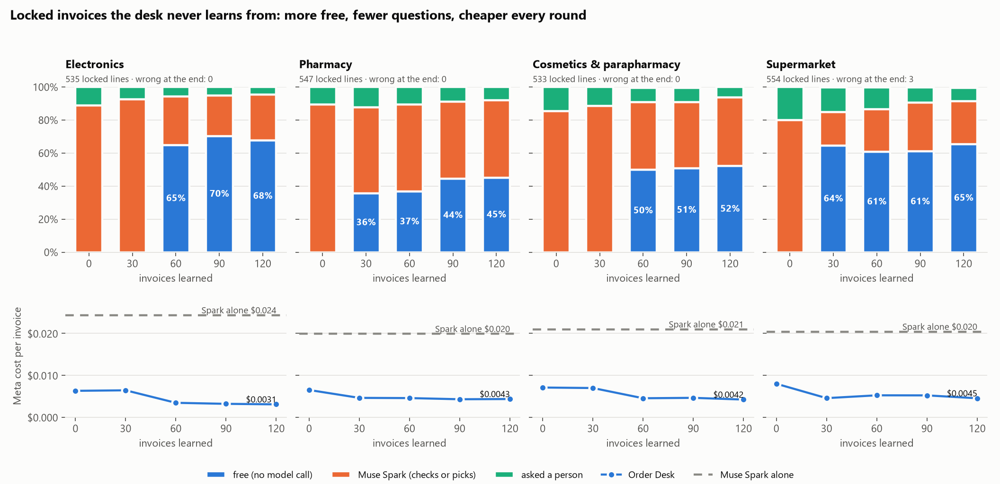

# Benchmark: the details

The summary is in the [README](../README.md#benchmark). Every number here comes from the files in
[`bench/`](../bench/), and `python bench/check.py` prints them again in a second, with no API key.
[`bench/README.md`](../bench/README.md) says what each file is and how to run everything again.

- [Supplier invoices, four industries](#supplier-invoices-four-industries)
- [What the desk learned, and from whom](#what-the-desk-learned-and-from-whom)
- [Seen before, or first seen: the two numbers a careful judge computes](#seen-before-or-first-seen)
- [Shop orders: 200 orders, five channels](#shop-orders-200-orders-five-channels)
- [What is real and what is synthetic](#what-is-real-and-what-is-synthetic)
- [Eight bugs the benchmark found](#eight-bugs-the-benchmark-found)
- [Earlier runs: hardware, a larger supermarket catalogue, the breaker](#earlier-runs-hardware-a-larger-supermarket-catalogue-the-breaker)
- [Reading invoice images and hearing brand names](#reading-invoice-images-and-hearing-brand-names)

## Supplier invoices, four industries

Four real catalogues: electronics (796 products), pharmacy (524), cosmetics & parapharmacy (586) and
supermarket (587). For each, a stream of 150 invoices from 15 suppliers: 120 to learn from, 30 locked. The
desk is trained the way a clerk would train it: it reads each training invoice, a clerk who knows the right
product answers its questions and corrects its mistakes, and Muse Spark recalibrates the desk every 30
invoices (vocabulary, first-pass blocks, search, the rule engineer). **Locked invoices are never learned
from**: they are scored before training and after every round, with nothing answered or corrected.

| 30 locked invoices per industry, after 120 learned | Automatic (before → after) | Free, no model call | Asked | **Wrong** | Meta cost / invoice | Muse Spark alone (whole catalogue, 0.9 bar) |
|---|---|---|---|---|---|---|
| Electronics, 535 lines | 89 % → **96 %** | 68 % | 4 % | **0** | **$0.0031** | 96 % automatic, 1 wrong, $0.024 |
| Cosmetics, 533 lines | 85 % → **94 %** | 52 % | 6 % | **0** | **$0.0042** | 88 % automatic, 0 wrong, $0.021 |
| Supermarket, 554 lines | 80 % → **92 %** | 65 % | 8 % | **3** | **$0.0045** | 85 % automatic, 2 wrong, $0.020 |
| Pharmacy, 547 lines | 90 % → **92 %** | 45 % | 8 % | **0** | **$0.0043** | 98 % automatic, 0 wrong, $0.020 |
| **All, 2,169 lines** | **93 %** | **58 %** | | **3** | **$0.0040** | 92 % automatic, 3 wrong, $0.021 |

**Against Muse Spark alone.** Over the four industries the desk books 93 % automatically and Spark alone 92 %,
both with 3 wrong, and the desk costs 4–8× less per invoice. Per industry: the desk is ahead in cosmetics
(94 vs 88) and the supermarket (92 vs 85), ties in electronics (96 vs 96), and Spark alone is ahead in
pharmacy (98 vs 92). Spark alone costs the same on the thousandth invoice as on the first, and cannot hold a
20,000-product catalogue in one prompt.

**The learning curve, round by round** (automatic, wrong, Meta cost per locked invoice):

| After | 0 | 30 | 60 | 90 | 120 |
|---|---|---|---|---|---|
| Electronics | 89 % · 0 · $0.0063 | 93 % · 0 · $0.0064 | 94 % · 0 · $0.0034 | 95 % · 0 · $0.0032 | 96 % · 0 · $0.0031 |
| Cosmetics | 85 % · 0 · $0.0071 | 89 % · 0 · $0.0070 | 91 % · **2** · $0.0045 | 91 % · **2** · $0.0046 | 94 % · 0 · $0.0042 |
| Supermarket | 80 % · 0 · $0.0080 | 85 % · 2 · $0.0045 | 87 % · 2 · **$0.0052** | 91 % · 2 · $0.0052 | 92 % · 3 · $0.0045 |
| Pharmacy | 90 % · 0 · $0.0065 | **88 %** · 0 · $0.0046 | 89 % · 0 · $0.0046 | 91 % · 0 · $0.0043 | 92 % · 0 · $0.0043 |

Overall, every industry ends freer and cheaper than it started, but not every round is a step forward:
pharmacy dipped from 90 % to 88 % automatic after round 30, the supermarket's cost went up at round 60, and
cosmetics booked 2 lines wrong at rounds 60 and 90 before the last round removed them.

- **What learning bought.** Questions fell in every industry (supermarket 20 % → 8 %), and the share of
  lines booked with no model call went from 0 to 45–68 %. The desk earned autonomy after 21 to 46 invoices
  (supermarket 21, pharmacy 28, cosmetics 32, electronics 46): Muse Spark stopped checking every code answer
  and now checks only the risky ones.
- **Wrong bookings, read one by one.** The 3 at the end are all in the supermarket: `حليب ACTIVIA` ("Activia
  milk", the official Arabic name) on two invoices, which fits two Activia products, and Muse Spark picked
  the milk; and one product the catalogue lists twice (`NESQUIK CEREALES` / `CEREALE`).

<picture>
  <source media="(prefers-color-scheme: dark)" srcset="media/benchmark-dark.png">
  
</picture>

## What the desk learned, and from whom

- **What Muse Spark wrote.** Vocabulary like `mouse` → *souris*, `holder` → *support*, `حليب` → *lait*,
  `بسكويت` → *biscuit*; rules like *"`comp` or `comprimes` means `cp`"*, *"`lp`, `orod`, `disp`, `pelli` each
  name a release; two releases are never the same product"*, *"`pro`, `max`, `plus`, `ultra` name a variant"*.
- **Pharmacy's rules came from the Matching Profile.** The three live pharmacy rules were written by Muse
  Spark while it designed the desk's Matching Profile (author `muse-spark-profile` in
  `bench/results/stream/pharmacy/report.json`), not by the rule engineer. They answered 32 % of pharmacy's free
  lines (612 of 1,890, summed over the five test rounds).

**Who made the free answers possible.** `cmd/adaptive/credit.go` traces every free answer on the locked
invoices back to its origin. Summed over the five test rounds (8,624 free answers):

| | Free answers | A wording Muse Spark picked (and a person confirmed) or a rule it wrote | A plain catalogue match through the matching Spark designed | A wording first matched that way | Taught by a person |
|---|---|---|---|---|---|
| Electronics | 2,216 | 12 % | 59 % | 24 % | 4 % |
| Cosmetics | 2,281 | 10 % | 61 % | 25 % | 4 % |
| Supermarket | 2,237 | 8 % | 59 % | 27 % | 6 % |
| Pharmacy | 1,890 | 48 % | 25 % | 21 % | 5 % |
| **All** | **8,624** | **18 %** | **52 %** | **25 %** | **5 %** |

Read the middle columns for what they are: what Spark *wrote* (18 %) is a wording it found or a rule it
authored; what Spark *designed* (77 %) is a match through the normaliser, vocabulary and search that Spark
chose for the industry, and the credit gives Spark every plain catalogue match, whatever share the generic
normaliser played. The measured with/without comparison is the hardware run
[below](#earlier-runs-hardware-a-larger-supermarket-catalogue-the-breaker): without the matching Spark
designed, 46 % of lines were free instead of 74 %.

## Seen before, or first seen

**The desk learns each distributor's wordings: that is the product.** A supplier's software prints a product
the same way on every invoice, and a shop writes its usual products its usual way. So in the stream, **79 % of
the locked lines repeat a (supplier, printed wording) pair the desk saw in training** (electronics 81 %,
cosmetics 78 %, supermarket 80 %, pharmacy 79 %; 1,721 of 2,169). That is where the free path comes from.

**First-seen wordings are Muse Spark's job.** The printed set is the cold start: 160 invoices, 40 per
industry in 15 layouts each, where a supplier almost never sells the same product twice; only 2 % of its
locked lines (17 of 813) repeat a training pair. After 30 invoices, on 10 locked invoices per industry:

| Printed set, 813 locked lines | Desk: automatic | Wrong | $ / invoice | Muse Spark alone: automatic | Wrong | $ / invoice |
|---|---|---|---|---|---|---|
| Electronics, 209 | 88 % | 0 | $0.0020 | 98 % | 1 | $0.025 |
| Cosmetics, 191 | 87 % | 1 | $0.0046 | 87 % | 0 | $0.021 |
| Supermarket, 212 | 81 % | 1 | $0.0083 | 85 % | 2 | $0.022 |
| Pharmacy, 201 | 80 % | 1 | $0.0077 | 96 % | 0 | $0.021 |
| **All** | **84 %** | **3** | **$0.0057** | **91 %** | **3** | **$0.022** |

On wordings it has never seen, Spark alone books more lines (91 % vs 84 %), and the desk asks instead, at a
quarter of the cost. **The safety record holds either way: 3 wrong in 813 lines here, 3 in 2,169 in the
stream.** Of the desk's 3 here, one is a real error (a `500 G` typo for 500 mg, booked to the only box with
no size; it should have asked) and two are errors in the answer key, shown in the report.

## Shop orders: 200 orders, five channels

50 orders per industry, as shops send them on WhatsApp: **10 voice notes**, **10 typed in French**, **10 in
Darja in Latin letters**, **10 in Darja mixed with French in Arabic script**, and **10 screenshots** (a notes
app, a spreadsheet, a purchase order). Each went through the desks trained on the invoice stream above, with
nothing learned from the orders.

| 200 orders, 1,272 lines | Booked right | Right quantity and unit | Asked | **Wrong** | Missed by the reader | Meta cost / order |
|---|---|---|---|---|---|---|
| Typed: French · Darja (Latin) · mixed Arabic | 84 % · 84 % · 85 % | 100 % | 15–16 % | **1** | 0 % | $0.009 |
| Screenshots | 79 % | 100 % | 21 % | **1** | 0 % | $0.008 |
| Voice notes | 46 % | 94 % | 39 % | **1** | 15 % | $0.017 |
| **All** | **76 %** | **99 %** | 21 % | **3** | 3 % | **$0.010** |

Typed and screenshot orders: four lines in five booked with the right quantity and unit, the rest asked,
nearly nothing wrong. **Voice is the hard part**: the transcript of a Darja voice note comes back in Arabic
script, French product names included (`موتار دوسون غرام` for *moutarde 200 g*). Human voices are harder
than synthetic ones: on the 8 human recordings (32 lines) 8 lines were booked right, 15 asked, 9 missed by the
reader (28 %) and none wrong; on the 32 text-to-speech notes, 49 % right and 1 wrong. The desk asks rather than
guess, which keeps voice safe but slow; learning to correct what it hears is the next step.

## What is real and what is synthetic

| Data | Real or synthetic |
|---|---|
| The four catalogues | real product lists, cleaned (`bench/scripts/build_catalog_*.py`); the raw sources are not shipped |
| Wordings | pharmacy and cosmetics: real spellings seen in software lists, scanned invoices and nomenclatures, plus written variants; electronics and supermarket: written variants, plus the official Arabic (GS1) names |
| Invoice stream (600) | generated from the catalogues and wordings (`gen_stream.py`); suppliers are fictional |
| Printed set (160) | generated in 15 layouts per industry and rendered to PDF (`bench/invoices/`); **the benchmark replays the text printed on them**, so it measures matching, not reading |
| Shop orders (200) | written for the test in shop style; shop names are fictional |
| Voice notes (40) | **8 recorded by people**, 32 text-to-speech in Darja (26 Gemini TTS, 6 another voice generator); `bench/orders/voice/sources.json` names each one |
| Screenshots (40) | rendered by a browser from the order text (a notes app, a spreadsheet, a purchase order; `restyle.py`) |
| `samples/readbench` (18 "photos") | **computer renders** of the hardware invoices with skew, blur and JPEG noise (`tools/make_readbench.py`), not photographs |
| Hardware replay set | synthetic, shipped in `samples/` |

`bench/scripts/make_replay.py` and `gen_stream.py` regenerate the eight committed replay files byte for byte
from `bench/`.

## Eight bugs the benchmark found

Each was fixed during the event, seven of them with a regression test: sizes glued to a pack count
(`1LX12`); model codes read as pack counts (`HOCO X21`); phone memory written many ways (`8+256` = `8/256GB`, a
new `memory` block); a shortlist that could offer Muse Spark a product without the code the line states
(`X21` ≠ `X21PLUS`); a full brand read as an abbreviation of a shorter catalogue word (`GELTIM` matched
`GEL`); shop unit abbreviations (`ctn`, `fdx`, `bt`); long orders lost when Muse Spark's answer was cut off;
and the live server not loading the matching Muse Spark designed (the one without a test).

## Earlier runs: hardware, a larger supermarket catalogue, the breaker

These runs came first. They use **a synthetic hardware set** (612 products, shipped in `samples/`) and **a
different supermarket catalogue of 1,160 products** (a real store's, not shipped, with invoice lines written
for the test). The four-industry benchmark above uses the 587-product supermarket catalogue in
`bench/catalogs/`.

`cmd/adaptive` replays an invoice set: Muse Spark designs the profile; it checks every training line and a
clerk who knows the answers confirms or corrects it; the profile is calibrated twice, with the rule engineer
and the breaker at each calibration; then the desk is measured on invoices it never saw. Two baselines get
the same unseen lines: **Muse Spark alone** (`cmd/sparkalone`, the whole catalogue in one call, under 0.9
confidence goes to a person) and **the classic desk** (`cmd/replay`: aliases, rules and Spark picks, but no
matching designed by Spark).

| Hardware & electrical: 612 products, 18 unseen invoices, 186 lines | Booked right | Asked a person | **Booked wrong** | Meta model cost |
|---|---|---|---|---|
| Order Desk | 166 (74 % free, 16 % Spark pick) | 20 | **0** | $0.12 |
| Muse Spark alone, whole catalogue in every call | 165 | 20 | **1** | $0.43 |
| Classic desk, no Spark-designed matching | 140 (46 % free) | 45 | **1** | $0.09 |

| Supermarket / FMCG: 1,160 products, 20 unseen invoices, 234 lines | Booked right | Asked a person | **Booked wrong** | Meta model cost |
|---|---|---|---|---|
| Order Desk | 215 (89 % free, 3 % Spark pick) | 19 | **0** | $0.055 |
| Muse Spark alone, whole catalogue in every call | 231 | 3 | **0** | $0.46 |
| Classic desk, no Spark-designed matching | 211 (86 % free) | 23 | **0** | $0.02 |

- **Spark alone is an excellent reader**: 165 of 186 hardware lines right, 20 asked, 1 wrong; 231 of 234
  supermarket lines right, 3 asked, none wrong.
- **The desk makes its judgement permanent and cheap.** In hardware it booked one more line than Spark alone,
  with no wrong booking, for about a quarter of the cost; in the supermarket it asked 16 more lines than Spark
  alone, for an eighth of the cost. Spark alone needs the whole catalogue in every call: about 16,000 tokens
  per invoice for 1,160 products; 20,000 products would need about 280,000.
- **With and without the matching Spark designed.** The classic desk booked only 46 % of the hardware lines
  free instead of 74 %, and one wrong.
- **Who made the free answers possible** on the unseen invoices:

  | | Free answers | Muse Spark found it (a pick a person confirmed, or a rule it wrote) | Through matching Muse Spark designed | Taught by a person |
  |---|---|---|---|---|
  | Hardware | 137 | 36 (26 %) | 88 (64 %) | 13 (9 %) |
  | Supermarket (1,160) | 209 | 29 (14 %) | 159 (76 %) | 21 (10 %) |

- **Earned autonomy.** In the supermarket the code's answers cleared the 99 % bar after 31 invoices (Spark
  agreed with the code on all 267 lines it checked). In hardware one wrong answer in training (200 of 201)
  kept the desk supervised.
- **The breaker.** Against the 6 rules the rule engineer got through the gate in hardware, Muse Spark wrote 46
  look-alike lines (`VIS THC M8X25` for a socket screw against the rule `vis th` → *tête hexagonale*, `bouchon
  ppr dn25` against `ppr {n}` → `ppr d{n}`…). None was booked to the wrong product: on each one the desk asked.

The hardware profile turned on `split_glued`, `inch` (`15/21` → ½"), `dimensions` (`M8X20`), `units_glue` and
`pack_count` (`BT100`), learned `pc` → *prise* and `boulon` → *vis* from evidence, and refused `zn` and `th`
as vocabulary until rules with a supplier scope proved them.

Run it yourself on the hardware set (about $1.50 of Meta Model API credits):

```bash
go build -o adaptive ./cmd/adaptive                 # Windows: adaptive.exe
./adaptive -in samples/replay-hardware.json -out ./run-hardware -keys .env
go build -o sparkalone ./cmd/sparkalone && ./sparkalone -in samples/replay-hardware.json -keys .env   # about $0.45
go build -o readas ./cmd/readas
./readas -data ./run-hardware/desk "VIS TH M8X20 ZN BT100" "ROBINET 15/21"
```

`run-hardware/report.md` lists what Spark identified, every experiment with the gate's verdict and who made
the free answers possible. `adaptive -credit <db>` prints that table for an earlier run, `adaptive -break <db>
-keys .env` runs the breaker against a run's rules, and `readas` prints how a trained desk reads a line.

## Reading invoice images and hearing brand names

- **Two readers on invoice images** (`cmd/readbench`, 18 computer-rendered invoice images in
  `samples/readbench`: small print, skew, blur, JPEG). Muse Spark read 179 of 186 lines exactly and Muse Wonder
  182. Of Spark's 7 misreadings (`GA5030R` read as `GASO30R`, `ART9303` as `ART9383`…), the agreement check
  sent 5 to a person; 2 got through because both models misread them the same way, and 1 right line was
  flagged. The second reading costs about $0.026 per invoice.
- **Brand names as keywords** (`cmd/voicebench`, 30 French voice orders in a synthetic voice). Muse Voice
  Transcribe heard 65 of 71 brand names with the catalogue's brands as keywords and 11 of 71 without, at the
  same price.
