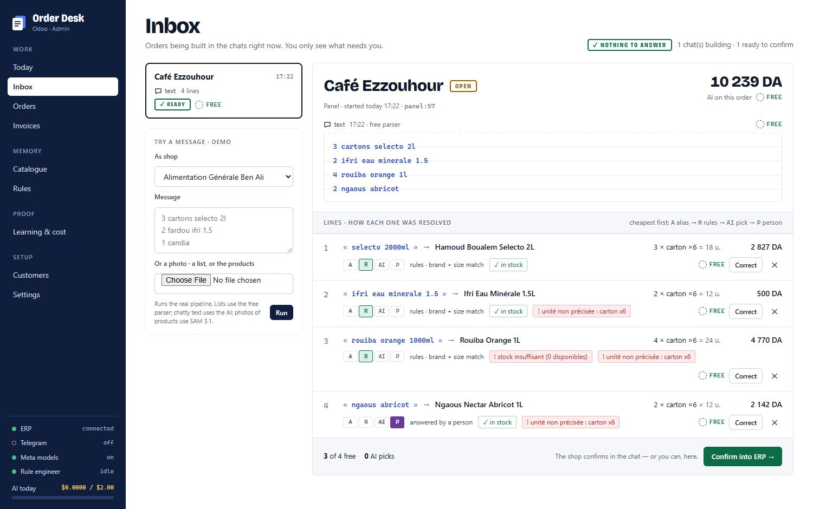
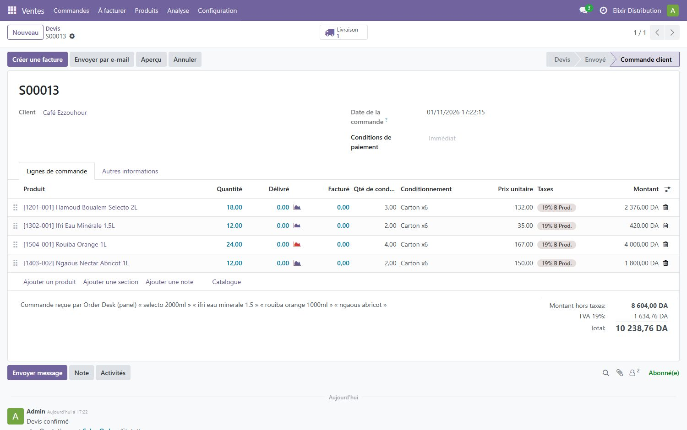
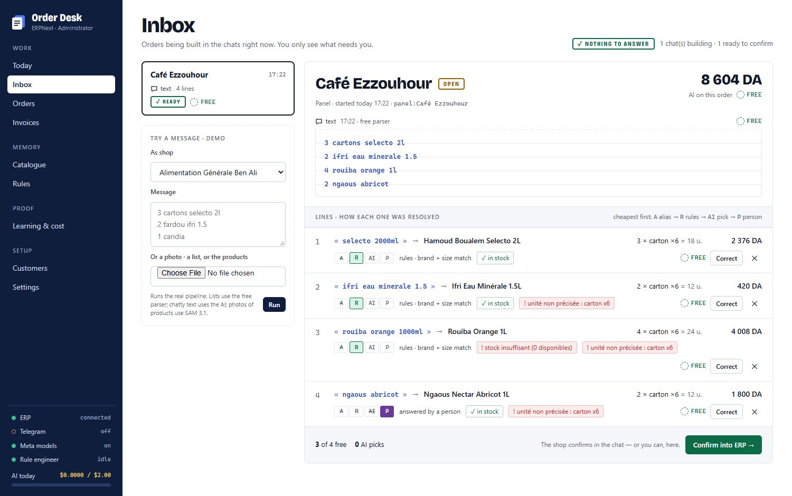
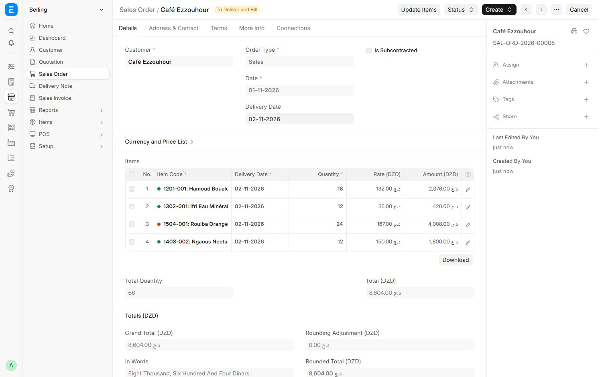
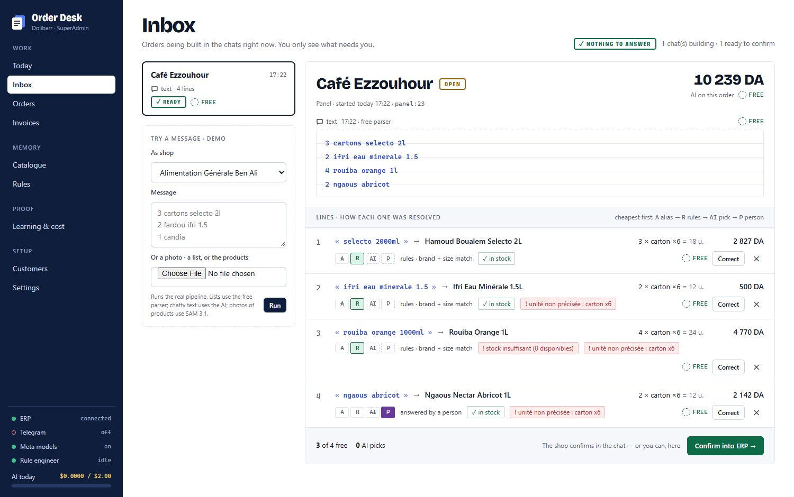
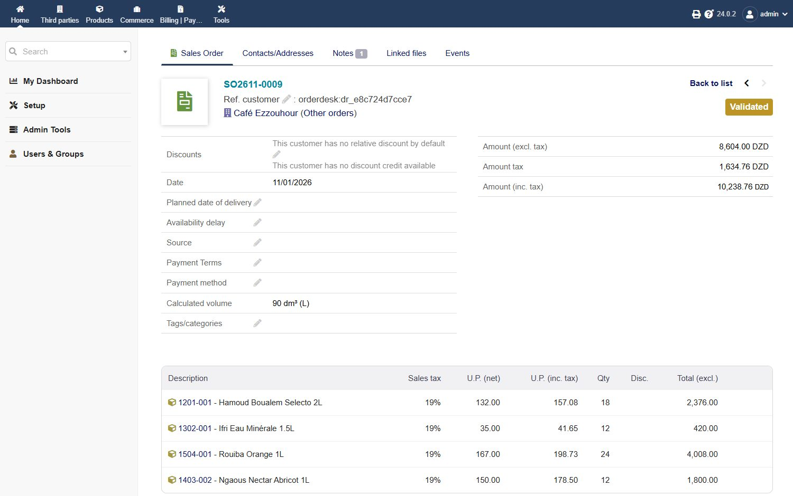
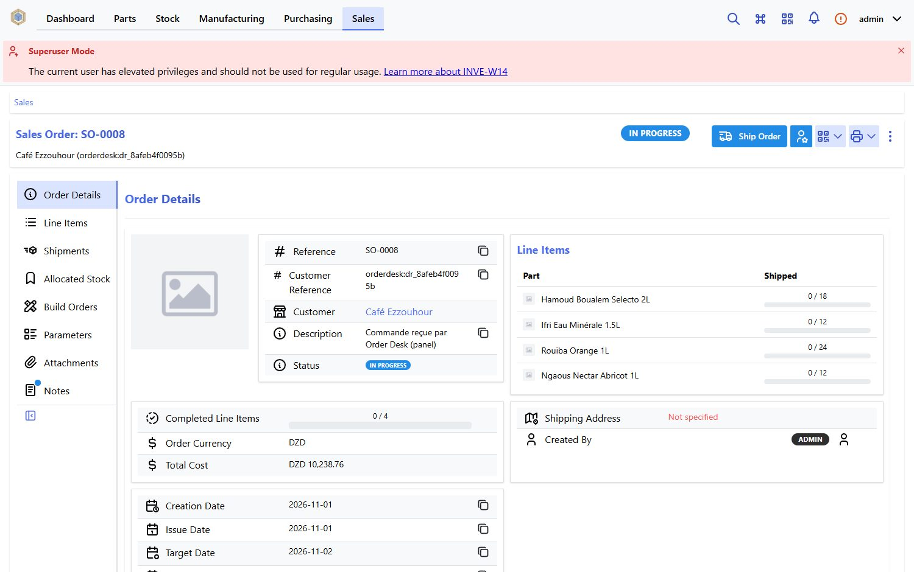
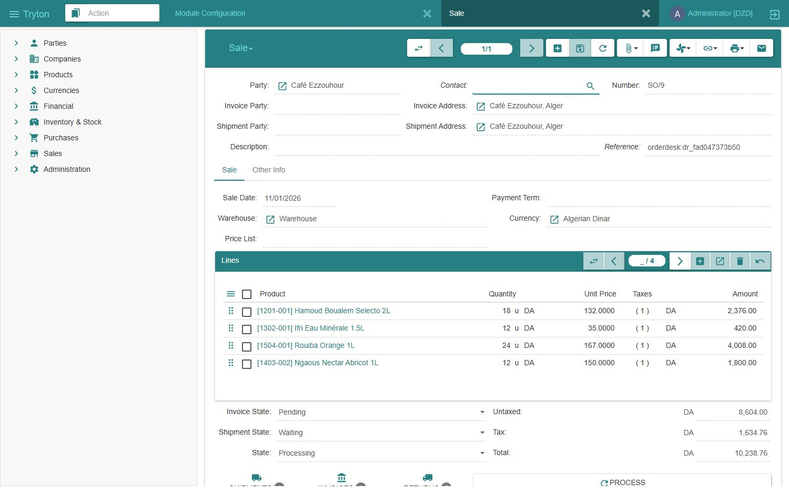

# Run Order Desk

The one-command demo is in the [README](../README.md#run-it). This page is the full setup: a real ERP in
Docker, the chat channels, every flag and setting.

- [What you need](#what-you-need)
- [The full demo with Odoo](#the-full-demo-with-odoo)
- [One order, five ERPs (screenshots)](#one-order-five-erps)
- [The other ERPs](#the-other-erps)
- [Chat channels: Telegram and WhatsApp](#chat-channels-telegram-and-whatsapp)
- [Configuration](#configuration)
- [Troubleshooting](#troubleshooting)
- [Repository layout](#repository-layout)

## What you need

| Tool | Version | Used for |
|---|---|---|
| [Go](https://go.dev/dl/) | 1.23 or newer | building Order Desk (the `-demo` needs nothing else) |
| [Docker](https://docs.docker.com/get-docker/) with Compose | any recent | the test ERPs |
| Python | 3.9 or newer, standard library only (no `pip install`) | the seed scripts, the simulators, `bench/check.py` |
| [ffmpeg](https://ffmpeg.org/download.html) | any, on the PATH | voice notes only |
| A Meta Model API key | from https://dev.meta.ai | the AI steps (optional, see below) |

**The Meta key is what makes the desk learn new wordings.** Without it the panel, the ERP connection, typed
orders, the learned wordings and rules, questions and booking all work; every line they cannot resolve goes
to a person, and voice notes, photos, invoices, the matching design and the rule engineer are off.

Commands are for a terminal opened in the repository folder. On Windows, use `py` if `python` is not found.

## The full demo with Odoo

**1. Get the code.**

```bash
git clone https://github.com/nudiiir/elixir-orderdesk.git
cd elixir-orderdesk
```

**2. Start Odoo and load the demo distributor** (120 drinks and dairy products with packs, prices, VAT,
barcodes and stock, 15 shops and 10 suppliers):

```bash
docker compose -f erps/odoo/docker-compose.yml up -d
```

Wait until http://127.0.0.1:8069 shows the Odoo page (about 30 seconds on the first start), then:

```bash
python erps/seed/odoo_setup.py
python erps/seed/odoo_seed.py erps/seed/seed.json
```

`odoo_setup.py` creates the database `orderdesk` with Sales, Purchase and Inventory (2–4 minutes). The Odoo
login is `admin` / `admin`.

**3. Configure.** `cp .env.example .env` (PowerShell: `Copy-Item .env.example .env`), then set
`META_MODEL_API_KEY`, and `TELEGRAM_BOT_TOKEN` if you want the Telegram channel. `.env` is git-ignored.

**4. Build and start Order Desk.**

```bash
go build -o orderdesk ./cmd/orderdesk             # Windows: go build -o orderdesk.exe ./cmd/orderdesk
./orderdesk -addr 127.0.0.1:8610 -data ./data     # Windows: .\orderdesk.exe -addr 127.0.0.1:8610 -data .\data
```

The start line reads `Order Desk panel on http://127.0.0.1:8610 (Meta: true, ERP: false)`.

**5. Connect the ERP.** Open http://127.0.0.1:8610 → **Settings** → **ERP connection**: ERP `Odoo`, address
`http://127.0.0.1:8069`, database `orderdesk`, user `admin`, key `admin`. Click **Connect**: the side bar shows
*ERP connected* and **Catalogue** lists 120 products. With a real Odoo, give an API key (Odoo → your profile →
Account Security → New API key), which you can revoke.

**6. Send an order.** **Inbox** → **Try a message**, choose a shop, paste and click **Run**:

```
3 cartons selecto 2l
2 ifri eau minerale 1.5
4 rouiba orange 1l
2 ngaous abricot
```

Each line shows how it was resolved (A alias, R rules, AI pick or P person) with its cost. "ngaous abricot"
waits for an answer: click **Ngaous Nectar Abricot 1L**, then **Confirm into ERP →**. The toast shows the Odoo
order number (`Order S00013 created in the ERP`), and Odoo → Sales has it, with the shop's words in the notes.
Send the same order again: the line you answered is now an alias, free. Try chatty text ("salam, mets moi 2
fardeaux ifri et 3 selecto"), or a photo of bottles with **Choose File**.

**7. Watch it learn.** **Learning & cost** shows lines resolved free vs by the AI, and every AI call with its
tokens and cost. **Rules** lists the rules Muse Spark proposed, the gate's verdict, the breaker's attack lines
and each rule's timeline (proposed → benchmark → shadow → live); **Run engineer now** starts a session, and it
also runs by itself once 50 lines have needed the AI or a person. **Catalogue** → a product shows every
wording learned for it.

## One order, five ERPs

The same order goes through the same desk into each of the five ERPs. Three lines resolve free (rules, brand
and size); "ngaous abricot" matches two products and is asked. The screenshots were taken by
`tools/capture_erps.py` against the Docker ERPs in `erps/`, with no manual step.

| ERP | In Order Desk | The order in the ERP |
|---|---|---|
| **Odoo 18** |  |  |
| **ERPNext v16** |  |  |
| **Dolibarr 24** |  |  |
| **InvenTree 1.6** |  |  |
| **Tryton 7.0** |  |  |

The question step for each ERP is in `docs/media/<erp>-1-question.jpg`.

## The other ERPs

Each ERP is started and seeded the same way; [ERPS.md](ERPS.md) has the live adapter tests and how to write an
adapter for another ERP.

| ERP | Start | Seed | Settings → ERP connection |
|---|---|---|---|
| Odoo 18 | `docker compose -f erps/odoo/docker-compose.yml up -d` | `python erps/seed/odoo_setup.py`, then `python erps/seed/odoo_seed.py erps/seed/seed.json` | `http://127.0.0.1:8069`, database `orderdesk`, `admin` / `admin` |
| ERPNext v16 | `docker compose -p od-erpnext -f erps/erpnext/pwd.yml up -d` (4 GB RAM; first start 3–5 min) | `python erps/seed/erpnext_setup.py erps/seed/seed.json` | `http://127.0.0.1:8090`, `Administrator` / `admin` |
| Dolibarr 24 | `docker compose -f erps/dolibarr/docker-compose.yml up -d` | `python erps/seed/dolibarr_setup.py erps/seed/seed.json` | `http://127.0.0.1:8081`, `admin` / `admin` |
| InvenTree 1.6 | `docker compose -f erps/inventree/docker-compose.yml up -d` | `python erps/seed/inventree_setup.py erps/seed/seed.json` | `http://127.0.0.1:8083`, `admin` / `admin` |
| Tryton 7.0 | `docker compose -f erps/tryton/docker-compose.yml up -d db`, then `… run --rm init`, then `… up -d tryton` | `python erps/seed/tryton_setup.py erps/seed/seed.json` | `http://127.0.0.1:8000`, database `orderdesk`, `admin` / `admin` |

All test instances listen on 127.0.0.1 only, with throwaway test logins. To switch ERP, connect another one in
Settings: the catalogue is synced again from it.

## Chat channels: Telegram and WhatsApp

Shops and the owner are linked with a **pairing code** from the panel: a shop's from **Customers → Pairing
code**, the owner's (for supplier invoices) from **Invoices → Pairing code**. Sending the code links the chat;
`/deconnecter` unlinks it.

**Telegram** uses long polling, so it needs no public address. In [@BotFather](https://t.me/BotFather),
`/newbot`, copy the token into `.env` as `TELEGRAM_BOT_TOKEN=…` and restart. Pair a shop, then order the way a
shop does (`3 selecto 2l, 2 cartons ifri, 1 candia`, a voice note, a photo). Questions come back as buttons;
**✅ Confirmer** books the order.

**WhatsApp** works through Meta's Cloud API or Twilio, and both need a public HTTPS address (a tunnel). To try
it **without any WhatsApp account**, `tools/whatsapp-sim` plays both Meta and a phone, locally. The three
setups are in [WHATSAPP.md](WHATSAPP.md).

## Configuration

```
orderdesk [-demo] [-addr 127.0.0.1:8610] [-data ./data] [-keys .env,whatsapp.env] [-no-telegram] [-public-readonly]
```

| Flag | Default | Meaning |
|---|---|---|
| `-demo` | off | the keyless judge desk: copies the shipped trained supermarket desk (`bench/trained-desks/supermarket`, 587 products) into the data folder (default `data-demo`) on first start, connects a stand-in ERP that writes orders to `<data>/demo-orders.jsonl` and goods receipts to `<data>/demo-receipts.jsonl`, and adds 3 demo shops |
| `-addr` | `127.0.0.1:8610` | panel, API and webhook address |
| `-data` | `data` | data folder: the SQLite database, voice notes, photos, invoices |
| `-keys` | `.env` if present | keys files with `KEY=value` lines, comma-separated (never printed) |
| `-no-telegram` | off | do not start the Telegram connector even if a token is set |
| `-public-readonly` | off | serve a read-only panel to other computers (with `-addr 0.0.0.0:PORT`): no personal data, no write controls; this computer keeps full access. The hosted demo runs with it |

| Variable (`.env`) | Needed for |
|---|---|
| `META_MODEL_API_KEY` | every AI step |
| `TELEGRAM_BOT_TOKEN` | the Telegram channel |
| `WHATSAPP_TOKEN`, `WHATSAPP_PHONE_ID`, `WHATSAPP_VERIFY_TOKEN`, `WHATSAPP_APP_SECRET` | WhatsApp through Meta's Cloud API ([WHATSAPP.md](WHATSAPP.md)) |
| `TWILIO_ACCOUNT_SID`, `TWILIO_AUTH_TOKEN`, `TWILIO_WHATSAPP_FROM`, `TWILIO_WEBHOOK_URL` | WhatsApp through Twilio |
| `FFMPEG` | the path to ffmpeg, if it is not on the PATH |

The ERP connection is made in the panel, not in `.env`; the other variables in `.env.example` are for the live
tests. **Settings** in the panel holds the learning thresholds (confirmations before an alias is trusted,
shadow agreements before a rule goes live, corrections before a rollback, the gate's minimum gain), the rule
engineer's models and schedule, the daily AI budget, and whether approved invoices are posted at once.

## Troubleshooting

| Symptom | Fix |
|---|---|
| `odoo_setup.py` fails with a connection error | Odoo is still starting: wait until http://127.0.0.1:8069 answers, then run it again |
| ERPNext seed fails right after `up -d` | the site is still being created: wait for `create-site` to exit (`docker compose -p od-erpnext -f erps/erpnext/pwd.yml logs -f create-site`) |
| Tryton connect says the database does not exist | run the `init` step once (`docker compose -f erps/tryton/docker-compose.yml run --rm init`) |
| The panel shows `the Order Desk panel only answers on this computer` | open it as `http://127.0.0.1:8610` or `http://localhost:8610`, not through a tunnel or a LAN address (or start with `-public-readonly` for a read-only view) |
| `Meta: false` in the start line | `META_MODEL_API_KEY` is not set: check `.env`, or pass `-keys path/to/file` |
| Voice notes fail | install ffmpeg, or set `FFMPEG` to its path |
| WhatsApp channel refuses to start | set `WHATSAPP_APP_SECRET` (Meta app → Settings → Basic) |
| Port 8610 is taken | start with another address: `-addr 127.0.0.1:8620` |

## Repository layout

```
cmd/orderdesk/        the program: panel + JSON API + Telegram + WhatsApp + workers (-demo: the keyless desk)
cmd/adaptive/         replays invoices through the adaptive pipeline; -credit (who made free answers possible), -break
cmd/sparkalone/       the baseline: Muse Spark alone, with the whole catalogue, on the same unseen lines
cmd/orderbench/       the 200 shop orders end to end through a trained desk
cmd/voicebench/       Muse Voice Transcribe with and without the catalogue's brands as keywords
cmd/readbench/        Muse Spark and Muse Wonder each read invoice images; scores the agreement check
cmd/replay/           replays invoices through the classic pipeline (before / learning / after)
cmd/readas/           prints how a trained desk reads a line
internal/catalog/     products mirror, packs, aliases, codes, normalisation, shortlist
internal/profile/     the Matching Profile: first-pass blocks, lexicon, the lab, Spark's design and calibration
internal/search/      BM25, trigram and word-similarity search, raced per desk
internal/rules/       the rule language: types, patterns, interpreter, sentences
internal/resolve/     the resolution ladder, the Muse Spark pick, the sentinel
internal/engineer/    the rule engineer (Muse Spark + tools), benchmark, gate, and the breaker
internal/desk/        the order agent: extraction, photos, drafts, questions, confirmation, learning,
                      supplier invoices read by Muse Spark and Muse Wonder, earned autonomy
internal/adapter/     the ERP contract and one adapter per ERP (odoo, erpnext, dolibarr, inventree, tryton,
                      elixir, demo); adaptertest/ is the live conformance test
internal/meta/        Meta Model API client with a cost meter and a daily budget
internal/telegram/    Telegram Bot API (long polling: no public address needed)
internal/whatsapp/    WhatsApp Cloud API webhook; internal/twilio/ the same through Twilio
internal/web/         panel and JSON API
bench/                the benchmark: catalogues, invoices, orders, every run, the trained desks, check.py
erps/                 Docker setups and seed scripts for the five open-source ERPs
samples/              a specimen supplier invoice, the hardware replay set and the invoice-image bench
tools/                WhatsApp simulator, invoice generator, invoice-image bench, ERP screenshots, demo recorder
docs/                 these pages, the live replay (demo/) and screenshots (media/)
```
